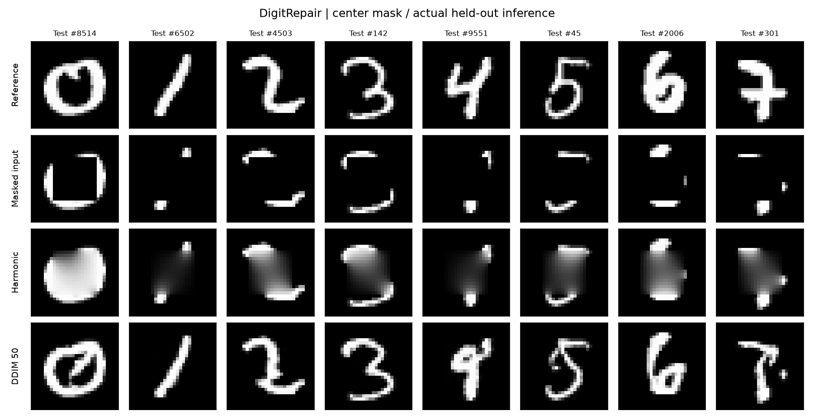
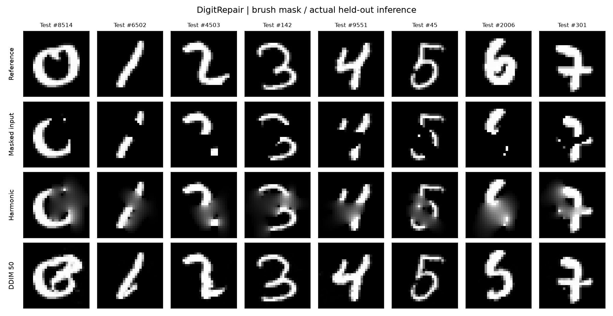
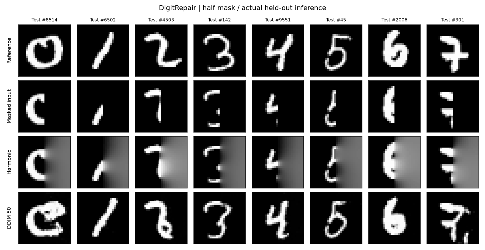
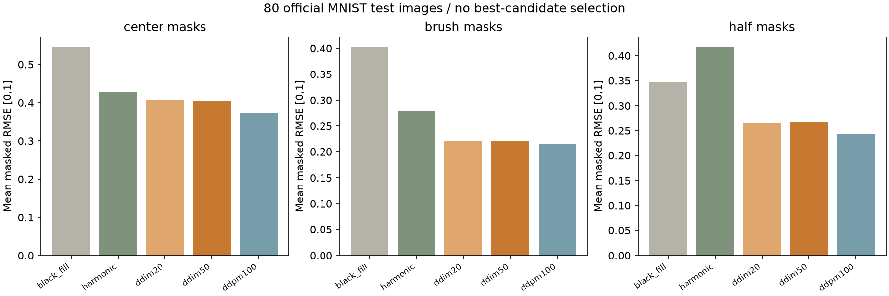
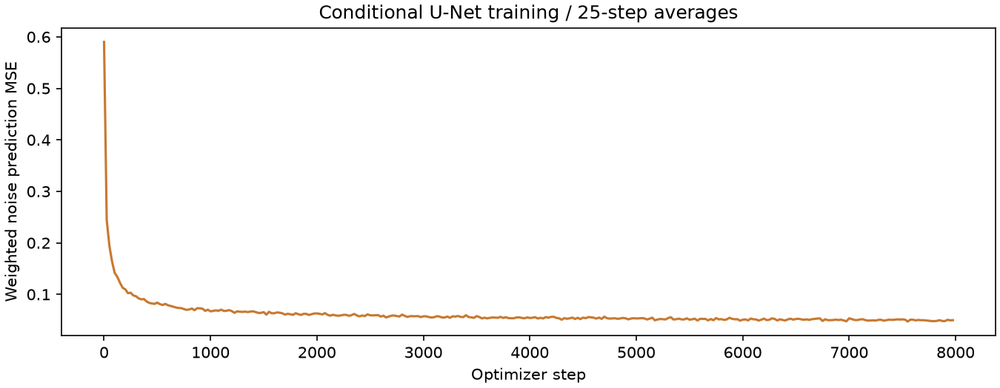
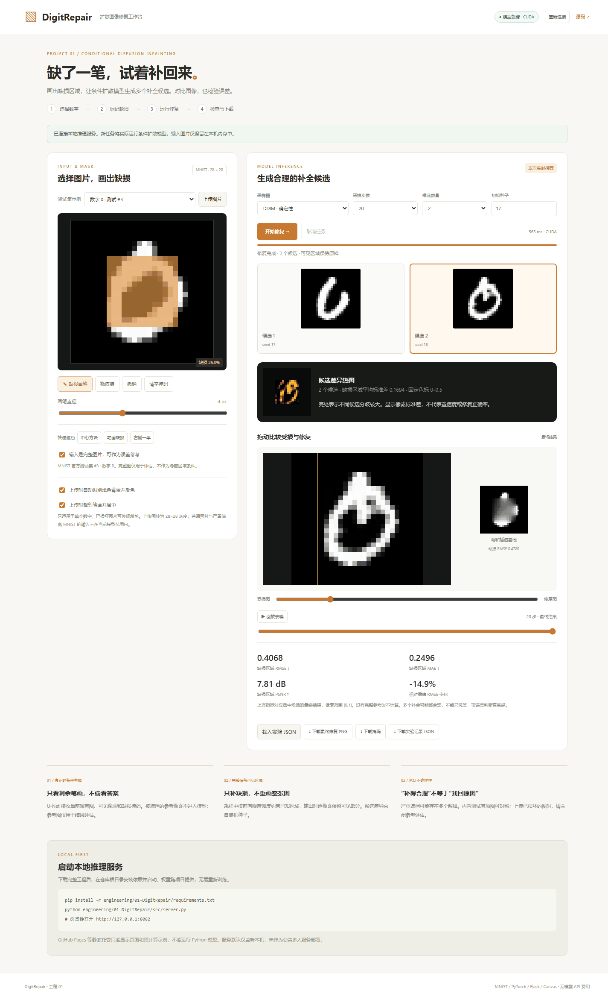
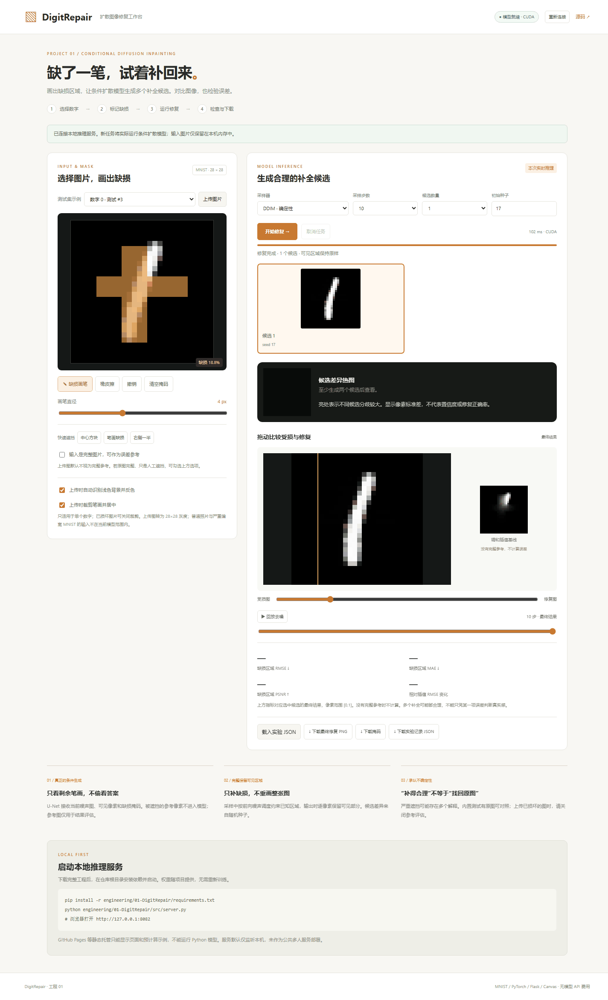
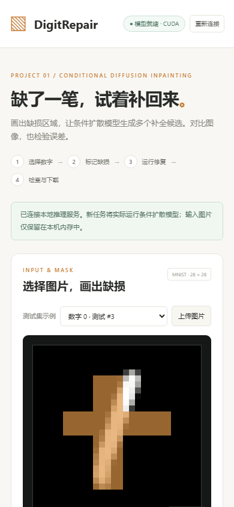

# 01 · DigitRepair：条件扩散手写数字修复工作台

**Web 前端 + Python 本地模型服务。** 用户选择 MNIST 测试图或上传单个数字图片，画出缺损区域，再实际运行条件 DDPM/DDIM 生成多个修复候选。支持任务进度、取消、去噪回放、受损/修复滑动对比、简单插值基线、结果 PNG 与实验 JSON 下载。

本项目是 MNIST 28×28 灰度数字上的教学与工程实现，不是通用照片修复工具，不复现 Palette 的大规模训练配置。当前工程目录仅保留本项目。

## 运行

推荐 Python 3.11+。下载整个仓库，在仓库根目录执行：

```bash
python -m venv .venv
# Windows PowerShell；macOS/Linux 使用 source .venv/bin/activate
.venv/Scripts/Activate.ps1
pip install -r engineering/01-DigitRepair/requirements.txt
python engineering/01-DigitRepair/src/server.py
```

浏览器访问 **http://127.0.0.1:8082/**。已训练权重位于 `results/repair.pt`，运行推理无需下载训练数据。自动选择 CUDA 或 CPU；可用 `--device cpu` 强制 CPU，也可用 `--port 8083` 更改端口。CUDA 需要与驱动匹配的 PyTorch，CPU 耗时取决于硬件。

只想查看页面：打开 `src/web/index.html` 可看到标注为“预计算示例”的真实结果；新的修复仍需后端。GitHub 文件页、GitHub Pages 与其他纯静态托管不能执行 Python 模型。服务默认只监听本机，不作为面向公众的多人服务部署。

## 使用流程

1. **选图**：20 张内置例子来自官方 MNIST 测试集，每类两张；也可上传 PNG/JPEG/WebP。
2. **标记缺损**：画笔、橡皮擦、撤销、清空；提供中心、笔画和半幅遮挡预设。掩码中 1 为待修复，0 为保留。缺损上限 70%。
3. **设置采样**：DDIM 支持 10/20/30/50/100 步；DDPM 使用完整 100 步。1–4 个候选分别使用 `seed+i`。
4. **实际推理**：前端提交异步任务，轮询真实进度；单推理工作线程，最多四个在途任务，可取消。
5. **查看与保存**：选择候选、滑动比较、回放真实中间状态；下载 28×28 PNG、掩码或完整实验记录。

### 参考图与指标

内置示例是完整图，人工遮挡后有真实参考，因此可以计算误差。上传图默认关闭“完整参考”选项；只有确认上传的是完整原图、缺损由网页人工制造时才应开启。

没有完整参考时，界面只展示候选、基线和耗时，**不计算 RMSE、MAE 或 PSNR**。参考图只参与评分，隐藏区域不作为模型条件。API 在接收输入后将缺损位置清零，再传给模型；测试包含隐藏像素扰动不影响输出的检查。

指标仅计算掩码内区域，像素范围 [0,1]。页面显示选中候选的最终结果，回放过程帧时不会把最终指标冒充中间帧指标。相对基线的 RMSE 变化为 `100 × (模型RMSE/基线RMSE − 1)`：负值表示误差下降，正值表示上升。误差为零时 PSNR 不输出无穷值。

### 上传预处理

浏览器将图像等比例缩放并置于 28×28 灰度画布；可按边框亮度自动反色，适配白纸黑字。支持最大 5 MB 文件、4096 像素边长。建议居中单数字、保留边缘留白。模型不保证能处理复杂背景、文字、照片或非 MNIST 风格。

## 模型与训练

- 数据：官方 MNIST 60000 张训练图、10000 张测试图，不用测试图训练。数据数组 SHA-256 见 [data_manifest.json](results/data_manifest.json)。
- 网络：三输入通道（扩散状态、可见像素、缺损掩码）的轻量 U-Net，通道 24/48/72、两次下采样、时间嵌入、GroupNorm 与残差块。无数字类别标签条件。
- 噪声：100 步 cosine 调度，训练预测噪声；损失在缺损区权重 1、可见区权重 0.1。
- 掩码：种子 42 预生成 4096 个随机方块/笔画掩码，训练中随机组合图像和掩码；不根据测试表现挑选掩码。
- 优化：8000 次参数更新，batch 128，AdamW 学习率 3e-4，梯度范数裁剪 1，EMA 更新率 0.005；CUDA 使用 bfloat16 混合精度。实际配置与损失见 [training.json](results/training.json)。
- 推理：DDPM 与 DDIM 复用同一权重。采样期间按前向噪声调度约束已知区域，最终逐像素复制可见部分；不修改已知像素。
- 基线：180 次四邻域调和插值，仅使用可见像素。它是简单基线，不代表传统修复算法的最佳水平。

多候选展示生成不确定性，不意味着自动找回唯一原图。大面积缺损可能生成与原数字不同但外观合理的结果；同样，低像素误差也不保证更自然。

## 重新训练与评估

首次准备数据需联网下载官方分割的 IDX 文件；也可从已有本地原始缓存准备：

```bash
python engineering/01-DigitRepair/src/ml/prepare_data.py
# 或：python engineering/01-DigitRepair/src/ml/prepare_data.py --source /path/to/MNIST/raw
python engineering/01-DigitRepair/src/ml/train.py --iterations 8000
python engineering/01-DigitRepair/src/ml/evaluate.py
python engineering/01-DigitRepair/src/ml/figures.py
```

训练数据写入忽略版本控制的 `data/`。训练每 2000 次更新保存 EMA 检查点。`--resume` 从已有 EMA 权重继续新的训练段，但重新创建优化器、EMA 和随机状态，不是逐位复现的断点续训。重新训练/评估会覆盖默认权重、结果与网页示例；模型服务需重启才能加载新权重。

评估固定从官方测试集每类抽取 8 张，共 80 张；分别使用中心、随机笔画和右半幅遮挡。比较黑色填充、调和插值、DDIM 20/50 步和 DDPM 100 步。每张图使用一个预设随机种子，不挑选多个候选中的最佳结果。报告的是逐图缺损 RMSE/MAE 的平均值；补充缺损墨迹区域的 RMSE，避免空白背景掩盖笔画误差。

本次只有一个训练种子与每图一个采样种子，不提供跨训练种子的置信区间，也不能据此证明在真实破损文档上的泛化性能。

## 实验结果

完整指标见 [metrics.json](results/metrics.json)，案例数组见 [cases.json](results/cases.json)。

| 遮挡类型 | 黑色填充 RMSE | 调和插值 RMSE | DDIM 20 步 | DDIM 50 步 | DDPM 100 步 |
|---|---:|---:|---:|---:|---:|
| 中心 | 0.5441 | 0.4288 | 0.4061 | 0.4055 | 0.3716 |
| 笔画 | 0.4015 | 0.2785 | 0.2215 | 0.2221 | 0.2159 |
| 右半幅 | 0.3462 | 0.4164 | 0.2651 | 0.2667 | 0.2432 |

本次 100 步 DDPM 相对调和插值的平均缺损 RMSE 分别下降约 13%、22%、42%。这不是分类准确率，也不保证每张图都改善。右半幅案例中，简单调和插值甚至不如黑色填充，说明该基线在这种任务上的局限。图中包含补全笔画或数字结构不正确的案例，不按结果好坏筛选。

训练模型共 483,745 个参数，本次优化训练段耗时 261 秒（RTX 5060 Laptop GPU，未计入前期数据准备和掩码池生成）。页面展示的运行耗时包含采样与中间帧保存，不含排队、插值基线计算、JSON 编码和网络传输，不能当作完整请求延迟。











## 运行截图







## 技术栈与目录

原生 HTML/CSS/JavaScript + Canvas；Flask 本地 JSON API；PyTorch 推理；NumPy 数据与指标；Pillow/Matplotlib 实验绘图。图片不发送给外部模型 API。任务与结果保存在服务进程内存中，最多保留 24 个任务，完成任务会在后续请求时按 30 分钟期限清理；停止进程即丢失。

```text
01-DigitRepair/
├── README.md / requirements.txt
├── src/
│   ├── server.py / engine.py
│   ├── web/                  # 前端、测试示例、真实预计算结果
│   └── ml/                   # 模型、训练、评估、绘图
├── results/                  # 权重、指标、案例与结果图片
├── tests/                    # 数值、API 与真实浏览器检查
├── screenshots/
└── data/                     # 本地训练数据，不提交仓库
```

## 验证

```bash
python -m unittest discover -s engineering/01-DigitRepair/tests -v
node --check engineering/01-DigitRepair/src/web/app.js
```

验证覆盖：请求约束、真实采样已知像素保留、隐藏参考不泄漏、掩码内指标、异步任务和取消。浏览器检查记录见 `results/browser-checks.json`，覆盖画笔、撤销、预设、真实推理、多候选、过程播放、无参考不显示指标和移动布局。

## 方法参考

- [DDPM](https://arxiv.org/abs/2006.11239) / [DDIM](https://arxiv.org/abs/2010.02502)
- [Palette 官方项目：条件扩散用于图像修复的研究背景，本项目不是完整复现](https://iterative-refinement.github.io/palette/)

## 本轮交互改进

- 上传时可自动反色、裁剪笔画并居中到 28×28，保留约 20×20 的笔画区域。已损坏图片可关闭裁剪，避免改变缺损布局。空白输入会提示重新选图。
- 下载的实验 JSON 可以重新载入图片、掩码、参考状态及采样参数；载入后必须重新推理，不直接相信文件中的旧结果与指标。JSON 限制 1 MB，加载前校验像素、掩码与参数。
- 多候选提供缺损区域的像素标准差热图；它表示候选间差异，不是概率、置信度或正确率。只有一个候选时不计算。
- 修改采样参数时标记当前仍为上次结果，防止将旧图误认为新参数的输出。

这些改进针对输入与实验操作；模型权重和已报告的固定测试集基准保持原来的实际训练结果。
