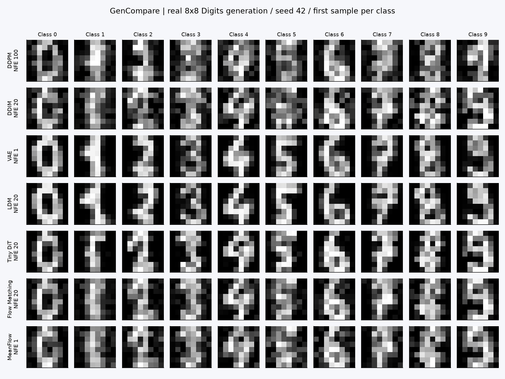
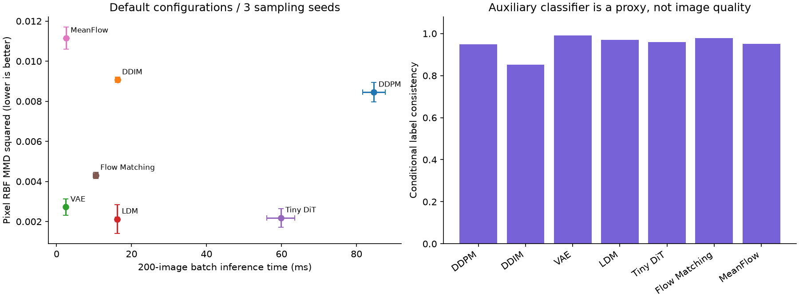
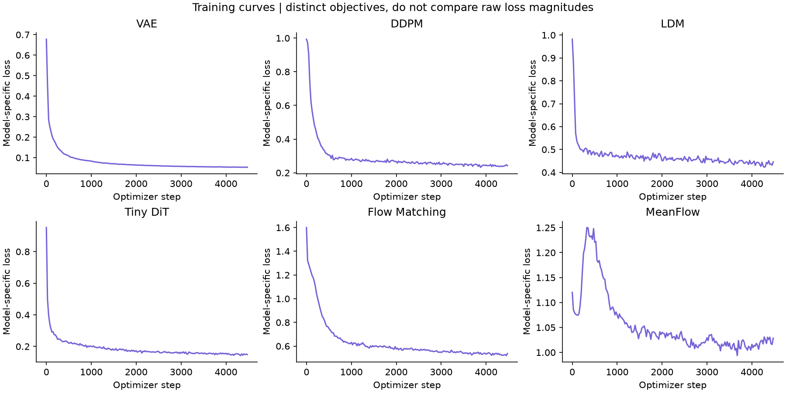
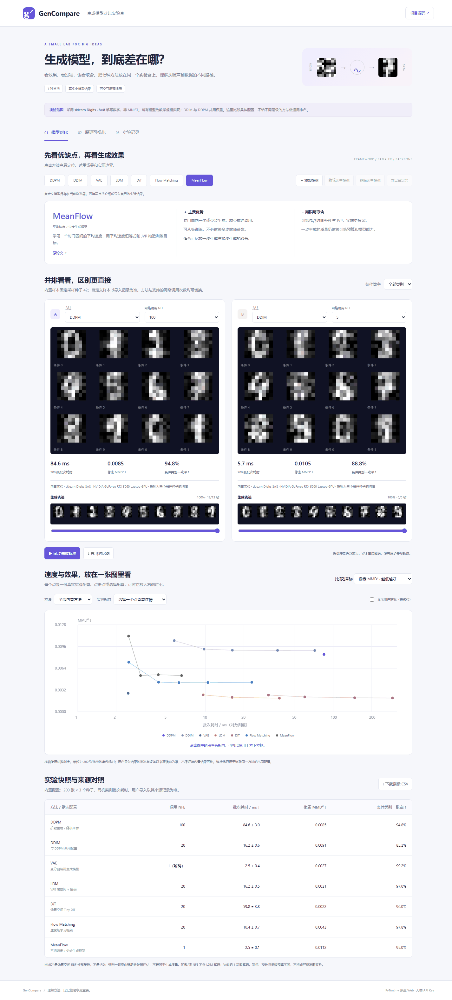
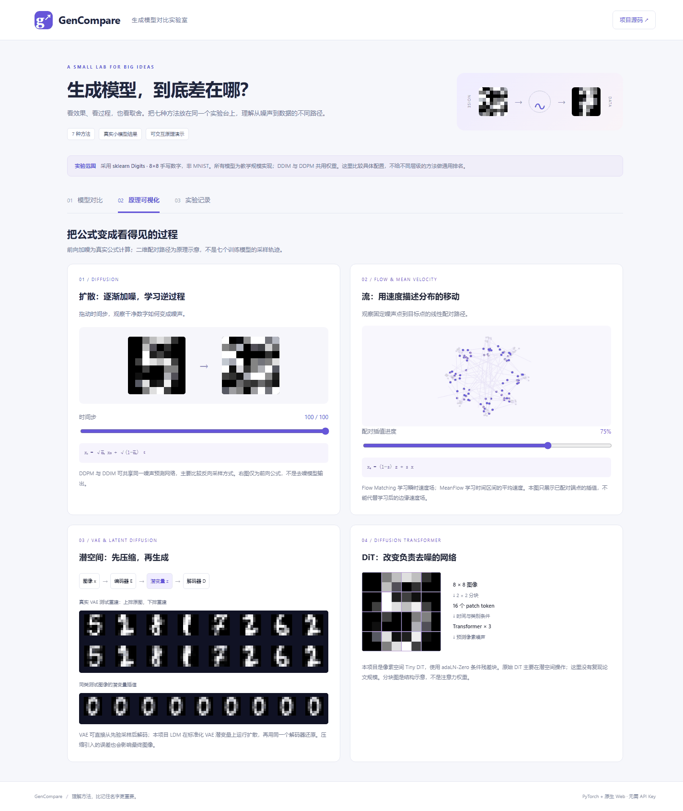
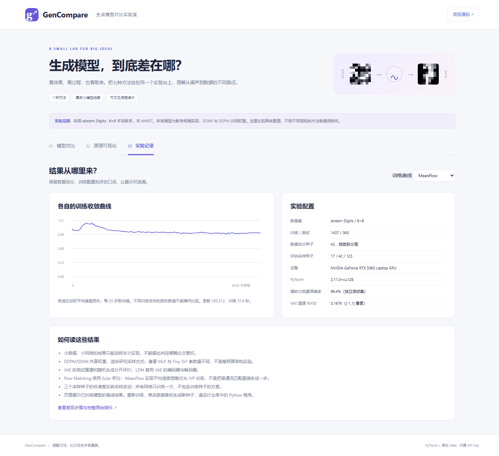
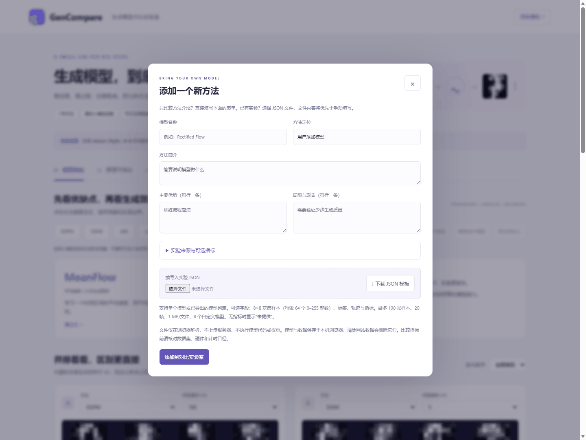

# GenCompare · 生成模型交互对比实验室

一个可离线运行的 **Web 项目**，直观比较 **DDPM、DDIM、VAE、LDM、DiT、Flow Matching、MeanFlow** 的原理、优缺点与小图像生成效果。支持用户自己添加方法、导入实验结果并参与比较。

采用轻量的 **scikit-learn Digits 8×8 手写数字**，不是 MNIST。内置样本来自实际训练的教学规模模型，浏览器展示预计算结果，不在网页中训练网络。项目不把不同层级的方法排成通用性能榜。

## 功能

| 模块 | 内容 |
|---|---|
| 方法优缺点 | 七种方法的定位、优势、局限、适用场景及原论文链接 |
| 生成效果对比 | 两种方法并排显示，切换数字类别、支持的 NFE、生成轨迹；导出对比 PNG |
| 速度—质量图 | 筛选方法、切换 MMD²/类别一致率，点击实验点或使用下拉框将配置同步到右侧对比 |
| 原理可视化 | 公式计算前向加噪、二维配对流路径、真实 VAE 重建与插值、DiT 图像分块示意 |
| 实验记录 | 参数量、训练曲线、设备、数据划分与真实指标；导出 CSV |
| 自定义模型 | 手动添加方法说明，或导入自己的样本、轨迹、指标 JSON；本地保存、编辑、明确移除选中项与导出 |

## 怎么运行

### 直接使用网站（零安装）

下载仓库后，双击 `engineering/01-GenCompare/src/index.html`。也可在仓库根目录启动静态服务器：

```bash
python -m http.server 8080 --directory engineering/01-GenCompare/src
```

打开 `http://127.0.0.1:8080/`。无需 API Key、账号、Node 构建、CDN 或模型下载。GitHub 文件页面只展示源码，不会执行 HTML，需要下载打开或使用静态托管。

### 重新训练与生成结果

推荐 Python 3.11+，在仓库根目录执行：

```bash
python -m venv .venv
# Windows PowerShell；macOS/Linux 使用 source .venv/bin/activate
.venv/Scripts/Activate.ps1
pip install -r engineering/01-GenCompare/requirements.txt
python engineering/01-GenCompare/src/ml/prepare_data.py
python engineering/01-GenCompare/src/ml/train.py --iterations 4500
python engineering/01-GenCompare/src/ml/figures.py
```

训练程序自动选择 CUDA 或 CPU，可加 `--device cpu`。CUDA 需使用匹配驱动的 PyTorch。使用已保存权重重新评估并更新页面数据：

```bash
python engineering/01-GenCompare/src/ml/train.py --evaluate-only
python engineering/01-GenCompare/src/ml/figures.py
```

训练/评估会覆盖 `results/` 对应文件和 `src/data/*.js`。本次使用 RTX 5060 Laptop GPU，六个生成网络训练合计约 126 秒，不含分类器、评估和绘图；CPU 时间取决于设备。页面的静态脚本已包含所有已导出配置，修改配置集合时需要同步修改 HTML 的 `data/*.js` 脚本引用。

## 用户如何添加自己的模型

点击“＋ 添加模型”：

1. **只比较原理与优缺点**：手动填写名称、方法定位、简介、优势与局限即可。未提供的样本和指标显示为空，不生成虚构结果。
2. **比较自己的实验结果**：下载 JSON 模板，填写实验信息、样本与指标后导入。文件内容优先于手动表单。
3. 新方法会加入方法说明、左右对比选择器和指标表。支持导出自定义模型，再在另一浏览器导入。
4. 在方法栏选中自己的模型，点击“编辑选中模型”可修改说明、来源和指标。手动编辑会保留原样本与轨迹；编辑时选择 JSON 文件则替换整份模型记录。只能移除选中的自定义模型，内置方法的编辑/移除按钮禁用。

“实验来源与可选指标”支持填写数据集、设备、计时批次大小与指标。用户导入结果不默认画在速度—质量图中，只有勾选“显示用户指标（未核验）”后才加入。缺少正耗时或所选指标的配置不绘制，不以零值代替；未经提供的误差范围也不显示为 ±0。图中比较不同设备、数据集和批次的耗时需自行核对口径。

数据保存在当前浏览器的 `localStorage`。清除网站数据、切换浏览器或访问不同站点地址不会自动同步。浏览器文件模式的存储行为也可能因浏览器而异，推荐使用静态服务器并定期导出备份。文件只在本地解析，不发送给服务器。

### 导入格式

示例只包含方法说明，未填写实验数据：

```json
{
  "name": "我的新方法",
  "category": "用户实验",
  "summary": "说明原理和本次实现。",
  "pros": ["主要优势"],
  "cons": ["局限或代价"],
  "nfe": 20,
  "provenance": "填写数据集、设备、样本数、随机种子与计时口径",
  "samples": [],
  "labels": [],
  "frames": [],
  "metrics": {}
}
```

| 字段 | 约定 |
|---|---|
| `name / summary` | 必填名称与简介；名称最多 50 字，简介最多 500 字 |
| `pros / cons` | 必填字符串数组，各 1–5 项 |
| `nfe` | 1–1000 整数，一份导入记录对应一个配置 |
| `samples` | 最多 100 张；每张为长度 64 的整数数组，值 0–255，按行展开 8×8 灰度图 |
| `labels` | 与样本数相同，取 0–9；不提供时记为 -1，表示无类别信息 |
| `frames` | 可选，最多 20 帧；每帧含 1–10 张同格式图像，按条件数字 0–9 排列 |
| `metrics.batch_ms` | 可选，非负批处理耗时，单位毫秒；请在来源说明样本量与硬件 |
| `metrics.mmd2` | 可选，非负分布差异；需与内置评估口径相同才有可比性 |
| `metrics.label_consistency` | 可选，0–1 的比例，不是百分数 |
| `provenance` | 建议填写实验来源、样本数量、随机种子和评估口径 |
| `dataset / hardware` | 可选，数据集名称与评估设备，分别最多 100/150 字 |
| `batch_size` | 可选，计时批次样本数，1–100000 整数 |
| `frame_labels` | 可选，与每一帧图像数相同，取 -1 或 0–9；不提供时显式轨迹默认按 0–9 排列 |

支持单个对象或对象列表。单文件不超过 1 MB，最多保存 8 个自定义模型。支持在当前浏览器移除自定义方法，内置方法不会被移除。导入内容始终标记为“用户导入，未核验”；HTML 文本按普通文字显示。

**新增的是方法介绍与实验结果，不是上传权重在线推理。** 本版本不执行用户 Python/JavaScript，也不加载用户 PyTorch 权重。不同数据集或指标口径的结果不应直接比较。

## 方法实现与比较口径

| 名称 | 本项目实现 | 主要取舍 |
|---|---|---|
| DDPM | 条件像素 MLP、100 步随机后验采样 | 基础清晰，多步生成成本较高 |
| DDIM | 复用同一 DDPM 权重，eta=0，5/10/20/50/100 步 | 无需重训，可研究加速与误差 |
| VAE | 条件变分自编码器，12 维潜变量 | 一次解码；压缩和先验匹配限制质量 |
| LDM | 冻结同一个 VAE，12 维标准化潜空间扩散 | 降低数据维度，但引入编码/解码误差 |
| DiT | 像素空间 Tiny DiT，2×2 patch、16 token、3 个 adaLN-Zero Transformer 块 | 更换去噪骨干，本项目不是原论文潜空间大模型 |
| Flow Matching | 线性条件路径、瞬时速度回归、Euler 采样 | 路径直观，少步积分会引入误差 |
| MeanFlow | 两时间条件、平均速度恒等式、JVP 与 stop-gradient 目标 | 面向一步/少步生成，训练更复杂 |

VAE 不属于扩散模型；DiT 是骨干架构，LDM 是潜空间框架，DDIM 主要用于采样对比。这些方法可以组合，不能视为互斥的七个同级算法。

### 数据与训练

- 数据集共 1797 张 8×8 灰度图；按类别分层划分 1437 训练、360 测试，种子 42。像素从 0–16 映射到 [-1,1]。训练与测试索引已保存，无重叠。
- 六个生成网络分别训练一次，每个 4500 次更新、batch 128、AdamW 学习率 3e-4、梯度范数裁剪 1、EMA 更新率 0.01。网络初始化由种子 42 的统一随机序列产生；各网络训练采样种子依次为 42–47。DDPM/DDIM 共享网络，不重复训练。
- DDPM、LDM、Tiny DiT 使用 100 步 cosine 噪声调度，回归噪声 MSE；像素 x0 裁剪到 [-1,1]，标准化潜变量 x0 裁剪到 [-4,4]。DDIM 重算裁剪后的噪声方向。
- VAE 使用重建 MSE + 0.02×KL，前 1000 次更新逐步增加 KL 权重；LDM 使用冻结编码器的后验均值，逐维用训练集统计标准化。
- Flow Matching 使用 `z_t=(1−t)x+tε`、目标 `v=ε−x`，时间 0 为数据、1 为噪声，生成时反向积分。
- MeanFlow 采样两时间 r≤t，50% 样本令 r=t；使用 `u_target=stopgrad(v−(t−r) du/dt)`，通过沿 `(v,1,0)` 的 JVP 计算总导数。损失按 `1/(stopgrad(MSE)+0.001)^0.75` 自适应加权，不使用教师蒸馏。
- VAE、LDM、DiT、扩散和流模型全部带数字类别条件，没有文本条件或 classifier-free guidance。

### 指标与计时

每配置生成 200 张、类别均衡，采样种子 17/42/123，记录均值与样本标准差。网页样本来自种子 42 的前 100 张，没有筛选效果；每条轨迹展示前十个条件类别的状态，最多均匀抽取 13 帧。

1. **像素 MMD²**：图像映射到 [0,1]，RBF 核 `exp(−||a−b||²/(64×2×0.5²))`，使用有偏估计，与全部 360 张测试图比较；不是 FID，不等同于感知质量。
2. **条件类别一致率**：独立训练的 MLP 分类器预测生成图类别，与条件标签比较；辅助分类器测试准确率约 96.4%。该指标无法单独衡量多样性或真实感。
3. **批次耗时**：单机生成 200 张，预热排除；计入种子设置、噪声生成、前向计算和必要解码，不含指标计算、轨迹导出、训练。CUDA 在计时边界同步，不是单图端到端延迟。
4. **最近训练样本 RMSE**：原始 JSON 中附带，用于观察生成样本与训练样本的距离，不直接当作质量排名，也不能证明没有记忆训练数据。

扩散/流模型的 NFE 指去噪/速度网络调用次数，LDM 还需一次解码；VAE 的 1 次就是解码器调用。LDM 的训练预算还包含 VAE 预训练，参数量需要同时考虑编码/解码组件。本实验没有严格匹配架构参数或总训练算力，也没有跨训练种子重复。

## 真实结果图







完整数值见 [metrics.json](results/metrics.json)。本次 20-NFE DDIM 比 100-NFE DDPM 批次耗时更低，但条件一致率也较低；MeanFlow 一步生成在本次小实验中没有取得最低 MMD。不要将此结果推广为论文方法的普遍优劣。

## 运行截图










## 技术栈与目录

前端：原生 HTML/CSS/JavaScript、Canvas、localStorage。计算：Python、PyTorch、NumPy。数据准备：scikit-learn。绘图：Matplotlib。数据准备与绘图分进程运行，避免 Windows 混用 OpenMP 运行库。

```text
engineering/01-GenCompare/
├── README.md / requirements.txt
├── src/
│   ├── index.html / style.css / app.js / enhancements.js
│   ├── model-dialog.html          # 自定义模型表单片段，已内嵌到 index.html
│   ├── data/*.js                  # 真实生成样本、轨迹与指标
│   └── ml/
│       ├── prepare_data.py
│       ├── models.py              # 六个生成网络与采样方法
│       ├── train.py               # 训练、评估、Web 数据导出
│       └── figures.py
├── tests/test_models.py / browser-checks.mjs
├── results/                       # 数据划分、权重、指标、结果图片
└── screenshots/
```

## 验证

```bash
python -m unittest discover -s engineering/01-GenCompare/tests -v
node --check engineering/01-GenCompare/src/app.js
```

浏览器使用单独的 Edge/Chrome 调试会话（`--remote-debugging-port=9222`），Node 22+ 下运行 `node engineering/01-GenCompare/tests/browser-checks.mjs` 可复查交互并更新截图。该脚本只清除测试页面的 `gencompare.custom.v1` 存储键，请使用专用测试浏览器配置目录。

浏览器检查覆盖七种模型、步数、类别筛选、同步播放、原理滑块、曲线、速度—质量图筛选与配置联动、手动新增、JSON 对象列表导入、非法指标拒绝、刷新持久化、模型编辑与样本保留、非顺序标签筛选、文本安全渲染、删除选中自定义模型与手机布局。记录见 [browser-checks.json](results/browser-checks.json)。

## 参考资料

- [DDPM](https://arxiv.org/abs/2006.11239) · [DDIM](https://arxiv.org/abs/2010.02502) · [VAE](https://arxiv.org/abs/1312.6114)
- [LDM](https://arxiv.org/abs/2112.10752) · [DiT](https://arxiv.org/abs/2212.09748)
- [Flow Matching](https://arxiv.org/abs/2210.02747) · [MeanFlow](https://arxiv.org/abs/2505.13447)
- [scikit-learn Digits 数据说明](https://scikit-learn.org/stable/modules/generated/sklearn.datasets.load_digits.html)

这些是教学实现，不复现论文的大数据、大模型配置，也不宣称达到论文性能。

