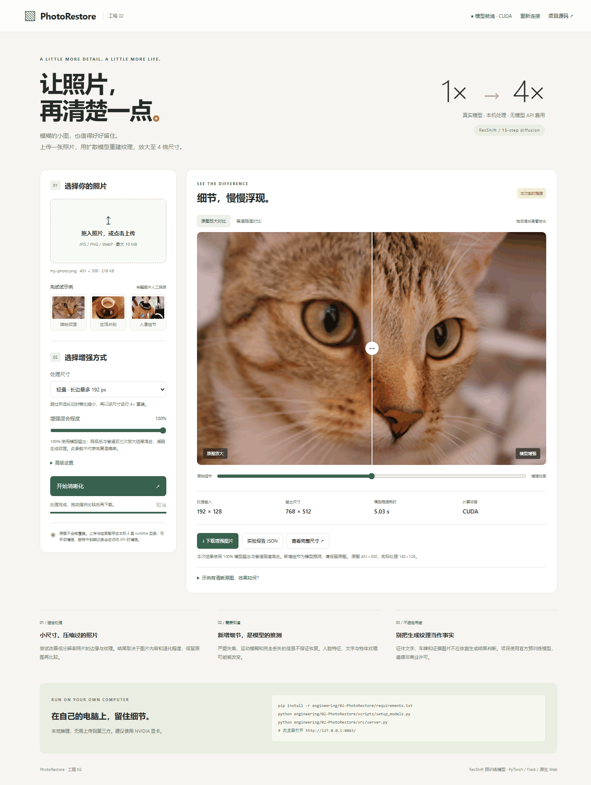
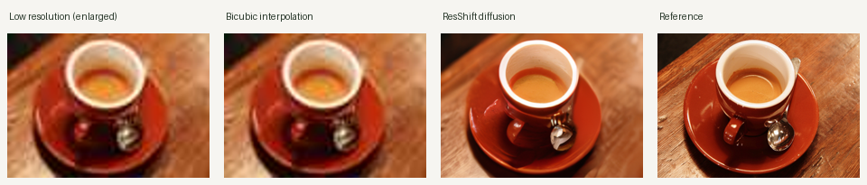
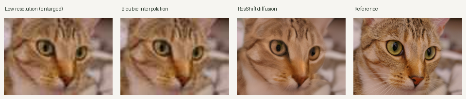
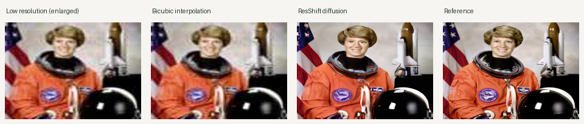
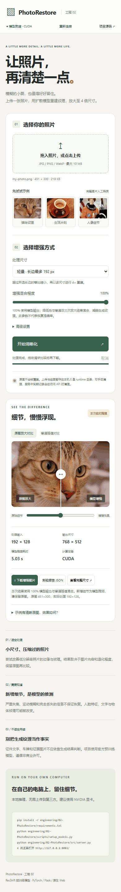

# 02 · PhotoRestore：照片清晰化工作台

上传低分辨率照片，通过 **ResShift 预训练扩散超分辨率模型**生成 4× 尺寸结果。支持 JPG/PNG/WebP、拖放上传、处理尺寸选择、增强混合程度、真实推理进度、取消、原图/普通插值对照、完整尺寸查看、PNG 与 JSON 报告下载。

**定位：已有预训练方法的 Web 工程应用，不是自行训练的新模型，也不是新的图像恢复算法。** 比较适合尝试增强低分辨率、压缩过的照片；严重失焦、运动模糊和已丢失的信息不保证恢复。新增人脸、文字和纹理细节可能偏离原图，不用于判断证件、车牌或证据内容。



## 本机运行

已在 Windows、Python 3.13、PyTorch 2.11 CUDA 12.8、NVIDIA RTX 5060 Laptop 8 GB 上完成实际推理验证。建议 Python 3.11+ 与兼容驱动的 PyTorch；默认自动选择 CUDA，没有显卡时可使用 CPU，但耗时会明显增加，CPU 完整推理未作性能验收。

### 你的 E 盘现成工程

模型已经下载到 `E:\all\engineering\02-PhotoRestore\weights\`，直接在 PowerShell 运行：

```powershell
python -B E:\all\engineering\02-PhotoRestore\src\server.py
```

保持终端运行，浏览器（Chrome、Edge 等）打开 **http://127.0.0.1:8083/**。项目 01 使用 8082，项目 02 使用 8083。终端按 Ctrl+C 停止服务；关闭后网页无法进行推理。

### 从 GitHub 新下载

在下载的仓库根目录执行，推荐把虚拟环境也建立在 E 盘的仓库内：

```powershell
python -m venv engineering/02-PhotoRestore/.venv
engineering/02-PhotoRestore/.venv/Scripts/Activate.ps1
pip install -r engineering/02-PhotoRestore/requirements.txt
python engineering/02-PhotoRestore/scripts/setup_models.py
python engineering/02-PhotoRestore/src/server.py
```

若要使用显卡，请先按 [PyTorch 官方安装说明](https://pytorch.org/get-started/locally/) 安装匹配驱动的 GPU 版本；项目不会自动更改驱动。可用 `--device cpu` 强制 CPU，或 `--port 8084` 修改端口。

两个模型总计约 **699 MB（约 667 MiB）**，保存在项目自身 `weights/`。GitHub 中不提交大权重，提供固定官方下载地址、大小与 SHA256 清单。首次下载需要网络；下载脚本自动校验完整性，已有正确权重时直接跳过。模型就绪后，推理不需要外部 API、账号或外部模型服务。

GitHub 目录页只用于查看和下载源码，GitHub Pages 无法运行 Python/GPU 推理。本工程尚未部署为公网网站；不能直接双击 HTML 代替本地服务。

## 使用方法

1. 上传一张低清照片，或选择猫咪、咖啡、人像示例。支持 PNG/JPEG/WebP，总请求上限 10 MB，图片上限 2000 万像素，长边至少 32 像素；不支持动画。
2. 选择处理输入长边上限：192、384 或 512 像素。大图会先等比缩小，再生成该处理尺寸的 4× 结果。例如 3000×2000 的图片选择 384 上限，处理约 384×256，输出约 1536×1024，**不是原始 3000×2000 的 4×**。界面与报告均标明实际尺寸。
3. 点击“开始清晰化”，等待本机实际推理。首次任务还需载入模型，可能比随后任务慢。进度基于实际完成的扩散采样步骤，不是预设动画。
4. 拖动对比滑块；可切换左侧为原图浏览器放大或普通双三次插值。右侧为本次生成的结果。
5. 下载 PNG 与实验 JSON。上传实际照片没有清晰参考，**不计算 PSNR/SSIM，也不显示虚构的清晰度提升百分比**。

增强混合程度 100% 为模型输出；0% 为普通双三次插值。中间值是两者的像素混合，仍会运行模型，不代表某种恢复置信度。改变尺寸、种子、混合程度后，旧结果会明确标记，需重新运行才生效。

任务取消在当前模型步骤完成后响应。页面刷新后不会自动恢复任务，离开前请下载需要的图片。

## 实际结果

下面三张完整源图先缩小至长边最多 384，再取可被 4 整除的参考尺寸。输入由参考图进行 4× BICUBIC 缩小、半径 0.4 的高斯模糊、JPEG quality=45 / subsampling=2 压缩得到。统一随机种子 2026，模型 15 步，混合程度 100%。

| 示例 | 普通插值 PSNR ↑ | 模型 PSNR ↑ | 模型推理耗时 |
|---|---:|---:|---:|
| 猫咪 | 26.76 dB | 26.32 dB | 2.39 s |
| 咖啡 | 22.69 dB | 23.33 dB | 1.46 s |
| 人像 | 21.44 dB | 20.76 dB | 2.16 s |

数值为完整 RGB 图像、像素范围 [0,1] 上的全图 PSNR，不裁边。耗时在模型载入后统计，包含分块、去噪、解码和融合，不包含首次载入、上传与文件保存。当前浏览器端真实上传测试：451×300 输入先缩小到 192×128，输出 768×512，2 个分块，模型推理约 5.03 s。更大输入通常耗时更长，不能把小图耗时当成统一承诺。

**三例中模型仅一例的 PSNR 高于插值。** 模型可产生更鲜明的纹理，但不一定更接近参考图。这里是三张演示图、一个降质设置和一个种子，不是独立大规模测试集，不宣称普遍优于插值，也不根据结果挑选种子。

左到右：低清图放大、双三次插值、扩散模型、完整参考。下图仅用于概览，等比例原始结果保存在对应文件夹。





记录见 [evaluation.json](results/evaluation.json)，各示例另含 `source.png`、`reference.png`、`input.png`、`baseline.png`、`output.png` 与 `report.json`。没有用滤镜或假进度替代模型推理。

## 技术实现与边界

- **前端**：原生 HTML/CSS/JavaScript，响应式布局、上传/拖放、滑块对比、对话框查看完整尺寸、下载。
- **后端**：Flask，单模型工作线程，最多 3 个在途任务。HTTP 请求提交任务后轮询真实状态，不在请求线程中长时间占用模型。
- **模型**：ResShift realSR ×4，官方 `s15_v1` 权重，15 步残差平移扩散，Swin U-Net 与 VQ autoencoder。
- **适配**：GPU 使用半精度的上游模型转换；VQ 单头注意力采用等价 PyTorch SDPA，含数值一致性测试。GPU 输入以 128×128 分块、32 像素重叠融合；CPU 使用 64×64 分块。分块可降低显存需求，但不是无缝质量保证。
- **复现**：种子、模型 SHA256、输入 SHA256、尺寸、分块数、设备、混合参数随报告导出。不同硬件或库版本可能存在数值差异。
- **隐私与存储**：图片不发往外部推理服务，上传文件的 EXIF 元数据不保留到处理后的 PNG。原始文件不会被覆盖。处理后的输入、结果和报告保存在本工程 `runtime/<随机任务ID>/`，该目录不提交到 GitHub。
- **缓存**：服务内存最多保留 8 条任务，完成记录到期 30 分钟后在后续 API 访问时清理，达到保留上限时可提前清理旧任务。服务重启后不会自动索引或删除旧 `runtime` 文件，因此停服后可以手动删除该项目的 `runtime` 目录释放空间。及时下载需要保留的结果。
- **运行范围**：默认只监听 `127.0.0.1`，没有账户、鉴权或公网部署配置；适合本机学习和工程展示。

## 复现实验与检查

三张源图已随工程保存，不需额外下载数据：

```powershell
python -B engineering/02-PhotoRestore/scripts/evaluate.py
python -B -m unittest discover -s engineering/02-PhotoRestore/tests -v
node --check engineering/02-PhotoRestore/src/web/app.js
```

8 项后端检查覆盖尺寸缩放、透明背景、EXIF 方向、无效图片、参数与上传大小、队列、取消、注意力数值一致性。

浏览器检查需先启动 8083 服务，并用专用配置启动 Chrome/Edge，开放本机 CDP 9222 端口；然后运行：

```powershell
node engineering/02-PhotoRestore/tests/browser-checks.mjs
```

12 项真实浏览器检查包括上传、多分块 GPU 推理、尺寸、原图/插值对照、PNG/JSON 下载、取消、完整尺寸查看、参数变更提示与 390px 手机布局。实际检查记录见 [browser-checks.json](results/browser-checks.json)。



## 目录

```text
02-PhotoRestore/
  src/engine.py           模型推理与分块融合
  src/server.py           Flask API 与静态页面
  src/web/                前端
  scripts/setup_models.py 官方权重下载、SHA256 校验
  scripts/evaluate.py     可复现实例
  tests/                  后端与真实浏览器检查
  weights/manifest.json   权重来源与校验值（大权重不提交）
  vendor/                 保留许可的上游推理源码
  results/                示例、原始输出和实验记录
  screenshots/            实际运行截图
```

## 来源与许可

使用了真实的 [ResShift 官方预训练模型](https://github.com/zsyOAOA/ResShift)，而不是从零训练或自行提出的模型。**上游 S-Lab License 1.0 限定非商业用途，商业使用需另行取得许可。** 上游固定版本、适配范围、图片作者与许可详见 [NOTICE.md](NOTICE.md) 和 [保留的上游许可](vendor/resshift/LICENSE)。
