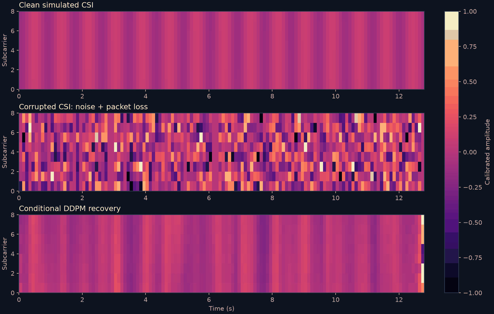
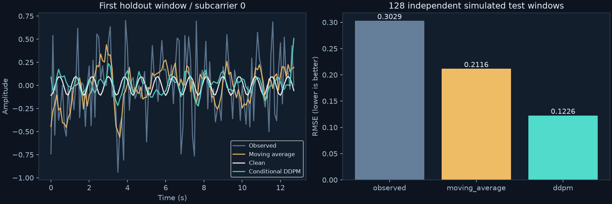
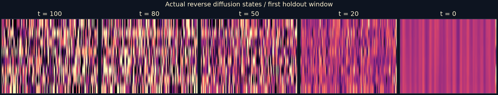
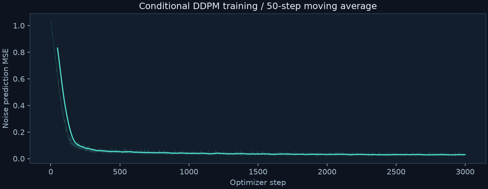
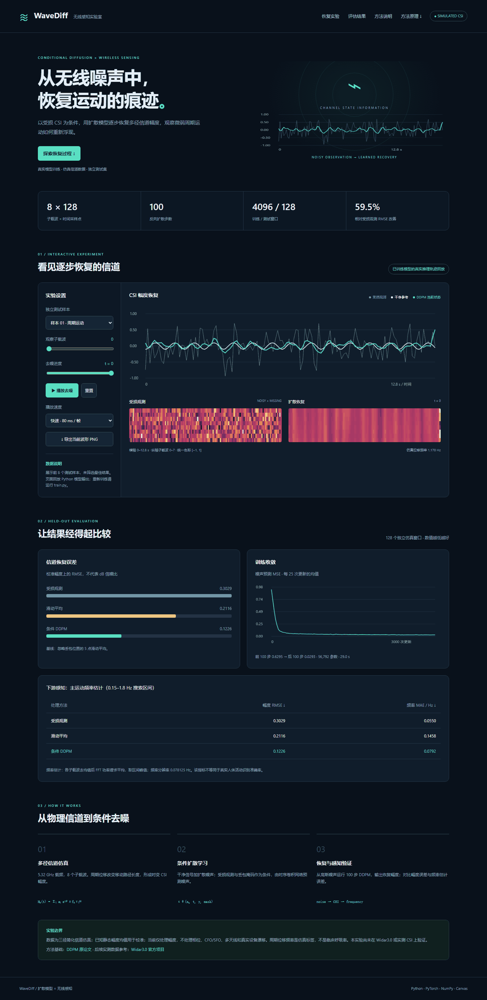
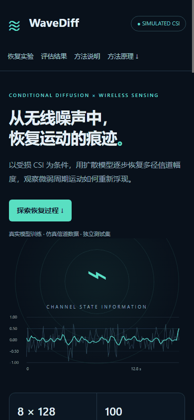

# WaveDiff · 扩散模型辅助无线感知

**项目类型：Web 应用。** 使用条件 DDPM 恢复噪声与丢包影响的 Wi-Fi CSI 幅度，展示反向扩散轨迹，并评估周期运动频率估计效果。

数据为简化多径信道仿真；模型经过实际训练，结果图来自实际推理。浏览器回放 Python 导出的推理轨迹，重新训练和采样在 Python 中运行。尚未在真实 Wi-Fi 设备或 Widar3.0 数据上验证。

## 功能

- 8 个独立测试样本、8 个子载波切换。
- 播放、暂停、重置、拖动扩散过程，三档播放速度。
- CSI 波形、受损与恢复热力图、训练曲线和评估表格。
- 与 5 点掩码感知滑动平均比较，报告幅度与感知频率误差。
- 导出当前波形 PNG，支持桌面与手机布局。
- 附训练源码、权重、完整测试数组、实际结果图与运行截图。

## 怎么运行

### Web 展示（无需安装依赖）

下载仓库后双击 `engineering/src/index.html`，自动进入实验页面。也可以在仓库根目录执行：

```bash
python -m http.server 8080 --directory engineering/src
```

打开 `http://127.0.0.1:8080/`。页面无 CDN、外部字体或 API 依赖，可离线打开。GitHub 文件页面只显示源码；运行页面需下载后打开或使用静态托管。

### 训练与复现

推荐 Python 3.11+，在仓库根目录运行：

```bash
python -m venv .venv
# Windows PowerShell 激活；macOS/Linux 使用 source .venv/bin/activate
.venv/Scripts/Activate.ps1
pip install -r engineering/requirements-wireless.txt
python engineering/src/wireless/train.py --iterations 3000
```

自动选择 CUDA 或 CPU，也可添加 `--device cpu`。CUDA 需安装与驱动匹配的 PyTorch。本次使用 RTX 5060 Laptop GPU，训练约 29 秒，不含评估与绘图；CPU 耗时取决于硬件。

复用附带权重重新评估：

```bash
python engineering/src/wireless/train.py --evaluate-only
```

仅重新绘图：

```bash
python engineering/src/wireless/plots.py engineering/results/wireless
```

默认输出到 `engineering/results/wireless/`，并更新 `src/wireless/demo-data.js`。再次运行会覆盖默认结果。`--output` 可改变权重与评估目录，但页面数据仍写回源码目录。

## 技术栈

| 部分 | 技术 |
|---|---|
| 界面 | HTML、CSS、原生 JavaScript、Canvas 2D；无构建依赖 |
| 训练与推理 | Python、PyTorch；CPU/CUDA |
| 仿真与评估 | NumPy |
| 实验绘图 | Matplotlib，独立进程运行以避免 Windows OpenMP 冲突 |

## 方法与实验设置

### 多径 CSI 仿真

采用三径复信道，两个静止路径、一个发生正弦位移的路径：

```text
H_k(t) = Σ_l a_l exp(−j 2π f_k d_l(t)/c)
d_moving(t) = d_0 + A sin(2π f_motion t + phase)
```

载频 5.32 GHz，子载波间隔 312.5 kHz；8 个子载波，每窗口 128 点，采样率 10 Hz，时长 12.8 秒。位移幅度 1.5–6 mm，频率来自 0.18–0.42 Hz 或 0.9–1.6 Hz 两段范围。这是周期运动教学仿真，不等同于真实呼吸或步态。

对 `abs(H)` 按子载波去除干净窗口均值，再除以固定尺度 0.25。**已知干净均值是理想校准假设**；真实数据需另行设计校准流程。加入标准差 0.15–0.45 的高斯噪声，每窗口丢包概率随机取 5%–20%。同一时刻所有子载波同时丢包，缺失位置填零并提供有效包掩码。

训练 4096 个窗口（种子 42），测试 128 个窗口（种子 20261018），独立生成但来自相同参数分布。页面固定展示前 8 个测试样本，不筛选最佳结果；不能据此推断跨场景泛化。

### 条件 DDPM

网络输入扩散状态 `x_t`、受损观测 `y`、掩码 `m` 与时间步 `t`，通过正弦时间嵌入、1D 卷积、GroupNorm、SiLU 和四个膨胀卷积残差块预测噪声，共 **56,792 参数**。

```text
x_t = sqrt(alpha_bar_t) x_0 + sqrt(1-alpha_bar_t) epsilon
loss = mean((epsilon_theta(x_t,t,y,m) - epsilon)^2)
```

100 步 cosine 调度，AdamW 学习率 3e-4，batch size 64，3000 次参数更新，EMA 更新率 0.01。采用完整 100 步随机 DDPM 与后验方差采样，预测 `x_0` 限制到 [−2, 2]，采样种子 2026。该项目不是 RF-Diffusion 或其他无线扩散论文的完整复现。

### 基线和评估

基线对填零观测做 5 点滑动平均，再除以掩码的滑动均值；边界复制端点。幅度 RMSE 在全部 128×8×128 元素上计算，包含丢包位置，单位为校准幅度，不是 dB。

频率估计：逐子载波去均值并计算 FFT 功率谱，平均后在 0.15–1.8 Hz 区间取峰，与仿真位移频率比较 MAE。频率分辨率 0.078125 Hz，未做插值，可能受到谐波影响。

## 实际实验结果

| 方法 | 幅度 RMSE ↓ | 运动频率 MAE / Hz ↓ |
|---|---:|---:|
| 受损观测 | 0.3029 | **0.0550** |
| 掩码感知滑动平均 | 0.2116 | 0.1458 |
| 条件 DDPM | **0.1226** | 0.0792 |

DDPM 幅度 RMSE 相对受损观测下降 **59.5%**，相对滑动平均下降约 **42.1%**。训练前 100 次更新平均噪声预测 MSE 为 0.6295，后 100 次为 0.0293。

**频率误差优于滑动平均，但没有优于受损观测。** 幅度恢复改善不保证下游感知改善。结果仅对应单次训练、一个测试集合与单个采样种子，没有重复实验置信区间或消融实验，不能宣称全面优于传统算法。

原始记录见 [metrics.json](results/wireless/metrics.json)，测试数组见 `evaluation.npz`，权重见 `model.pt`。本次使用 Python 3.14.6、PyTorch 2.11.0+cu128、NumPy 2.4.6；不同环境可能有数值差异。

### CSI 热力图



### 波形和独立测试误差



### 真实反向扩散轨迹



### 实际训练曲线



## 运行截图





## 目录

```text
engineering/
├── README.md
├── requirements-wireless.txt
├── src/
│   ├── index.html                 # Web 入口
│   └── wireless/
│       ├── index.html / style.css / app.js
│       ├── demo-data.js           # 实际推理轨迹和指标
│       ├── model.py               # 仿真、条件网络、DDPM
│       ├── train.py               # 训练、独立测试、导出
│       └── plots.py               # 结果绘图
├── tests/test_wireless.py
├── screenshots/                   # 桌面与手机截图
└── results/wireless/
    ├── model.pt / evaluation.npz
    ├── metrics.json / browser-checks.json
    └── *.png                      # 四张实验结果图
```

## 验证与边界

```bash
python -m unittest discover -s engineering/tests -v
node --check engineering/src/wireless/app.js
```

已用 Edge 无界面浏览器验证样本加载、指标行、重置、样本/子载波切换、播放至 t=0，以及 390px 布局无横向溢出；无 JavaScript 异常。记录见 [browser-checks.json](results/wireless/browser-checks.json)。截图为真实页面渲染。

当前仅处理仿真幅度，未处理相位、CFO/SFO、多天线、真实设备漂移或真实活动分类。真实数据接入需完成读取、幅相校准、采样率对齐和按人员/场景拆分。后续应增加带通滤波、Wiener 等基线、频谱一致性损失、多种子实验，并用实测 CSI 验证。

## 参考

- [DDPM 原论文](https://arxiv.org/abs/2006.11239)
- [Widar3.0 官方项目与数据说明：后续实测参考，本次未使用](https://tns.thss.tsinghua.edu.cn/widar3.0/index.html)
