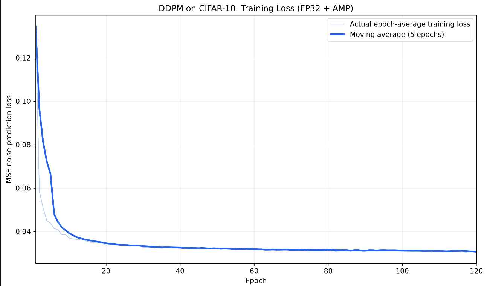
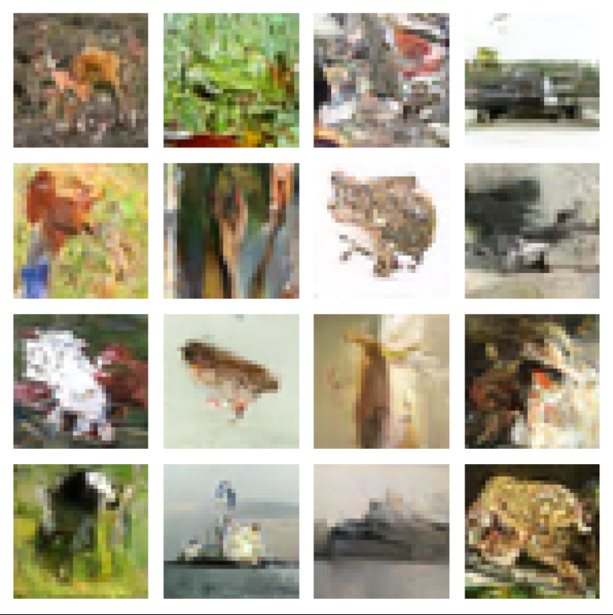
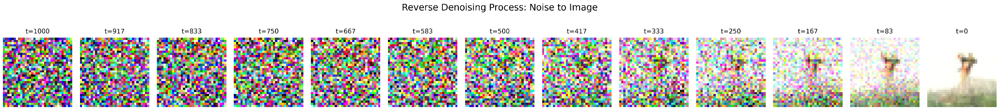

# DDPM · Denoising Diffusion Probabilistic Models

- **作者：** Jonathan Ho、Ajay Jain、Pieter Abbeel
- **出处：** NeurIPS 2020
- **论文：** [arXiv](https://arxiv.org/abs/2006.11239) · [全文](https://arxiv.org/html/2006.11239v2)
- **项目与代码：** [作者项目页](https://hojonathanho.github.io/diffusion/) · [官方代码](https://github.com/hojonathanho/diffusion)
- **关键词：** 前向加噪、反向生成、噪声预测、U-Net、变分下界

## 1. 这篇论文讲什么？

DDPM 学习如何从随机噪声中逐步生成数据。训练时，把真实图像加噪得到不同噪声程度的样本，让网络预测其中的噪声；生成时，从高斯噪声出发，多次调用网络，逐步得到图像。

它学习的是训练数据的分布。生成新样本时，不需要先提供一张真实图片，也不是记住某次加噪过程后原路返回。

## 2. 前向过程：把数据逐渐变成噪声

设原始图像为 $x_0$，扩散步数为 $T$，每一步的噪声方差为 $\beta_t$：

$$
q(x_t\mid x_{t-1})=
\mathcal{N}\left(\sqrt{1-\beta_t}\,x_{t-1},\beta_t I\right).
$$

定义 $\alpha_t=1-\beta_t$，$\bar{\alpha}_t=\prod_{s=1}^{t}\alpha_s$，可以直接从原图得到任意一步的加噪样本：

$$
x_t=\sqrt{\bar{\alpha}_t}\,x_0+
\sqrt{1-\bar{\alpha}_t}\,\epsilon,\qquad
\epsilon\sim\mathcal{N}(0,I).
$$

前一项是保留下来的图像信息，后一项是加入的噪声。噪声调度充分时，末端分布接近标准高斯。

**训练不必每次都从第一步加噪到第 $T$ 步。** 随机选一个 $t$，利用这个公式就能直接得到 $x_t$。

## 3. 网络到底学什么？

常用参数化让网络 $\epsilon_\theta(x_t,t)$ 预测上述公式中的噪声 $\epsilon$，采用简化目标：

$$
L_{\mathrm{simple}}=
\mathbb{E}_{x_0,t,\epsilon}
\left[\left\|\epsilon-\epsilon_\theta(x_t,t)\right\|_2^2\right].
$$

| 符号 | 含义 |
|---|---|
| $x_t$ | 当前噪声程度下的图像 |
| $t$ | 扩散时间步，用来告诉网络噪声所处阶段 |
| $\epsilon$ | 训练时实际采样的高斯噪声，是监督目标 |
| $\epsilon_\theta$ | 网络预测的噪声 |
| $\theta$ | 训练中更新的网络参数 |

这个 $\epsilon$ 是从 $x_0$ 直接构造 $x_t$ 时使用的合成噪声，不应理解为最后一次转移中单独加入的那一小份噪声。

论文从变分下界推导训练目标，并采用简化的噪声预测损失；简化目标改变了不同时间步的权重，不能直接等同于完整负对数似然。

## 4. 反向过程：从噪声生成图像

先采样 $x_T\sim\mathcal{N}(0,I)$，随后从 $t=T$ 到 $1$ 迭代：

$$
x_{t-1}=
\frac{1}{\sqrt{\alpha_t}}
\left(
x_t-\frac{\beta_t}{\sqrt{1-\bar{\alpha}_t}}
\epsilon_\theta(x_t,t)
\right)+\sigma_t z.
$$

当 $t>1$ 时，$z\sim\mathcal{N}(0,I)$；最后一步令 $z=0$。$\sigma_t$ 是所选反向方差对应的标准差。

这里不仅有“减去预测噪声”，还包含尺度调整和随机项。网络只负责预测噪声，采样公式把预测值转换为下一步状态。不同时间步通常共享同一个网络，通过时间嵌入区分阶段。

## 5. 训练与生成有什么区别？

| 阶段 | 已知信息 | 主要操作 |
|---|---|---|
| 训练 | 真实图像、采样的时间步和噪声 | 构造加噪样本，预测噪声，计算损失并更新参数 |
| 生成 | 初始随机噪声、训练好的模型 | 固定模型参数，逐步反向采样得到新图像 |

U-Net 的编码部分提取多尺度特征，解码部分恢复空间分辨率，跳跃连接传递细节，时间嵌入提供噪声阶段信息。网络输出与输入图像同形状的噪声预测。

## 6. 与仓库 CIFAR-10 复现的对应

[DDPM 复现项目](../reproduction/01-ddpm-cifar10/) 已记录 120 Epoch AMP 训练、Loss 曲线、生成样本与去噪过程。以下是仓库中的个人实验图，不是论文原图：

Loss 下降表示噪声预测目标得到优化，图像生成质量仍需结合样本与独立指标判断。仓库结果不等于复现了论文的全部实验或指标，具体配置以 [实验说明](../reproduction/01-ddpm-cifar10/results/EXPERIMENT_GUIDE.md) 和实际脚本为准。

## 7. 与 DDIM、无线感知的关系

[DDIM 复现](../reproduction/02-ddim-cifar10/) 使用已有噪声预测模型进行更少步数的采样。训练好的模型与采样方法是两个不同层面，不能简单删除 DDPM 中间步骤来代替 DDIM 的更新规则。

结合已读的 [CLAR](02-CLAR.md)，可以把生成对象从图像换成 CSI，用生成样本补充动作识别训练。结合 [WiFi-Diffusion](05-wifi%20diffusion.md)，也可以把稀疏无线测量作为条件，生成完整地图。这些属于后续条件生成应用，需要对应的数据表示与训练设计，并非原始 DDPM 已经完成的无线实验。

## 8. 我的理解

DDPM 将复杂的生成任务分解为多个噪声阶段的预测任务。学习噪声与采样公式共同构成生成过程；它的多步采样也带来推理成本。理解这条主线，有助于继续学习 DDIM 加速、潜在扩散和无线条件生成。

[返回笔记目录](README.md) · [返回科研主页](../README.md) · [查看 DDPM 复现](../reproduction/01-ddpm-cifar10/)
