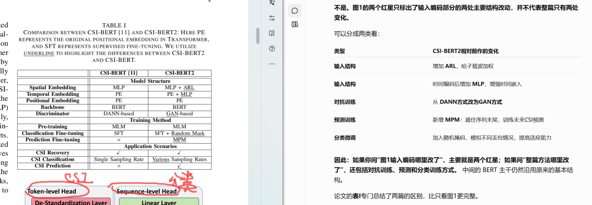
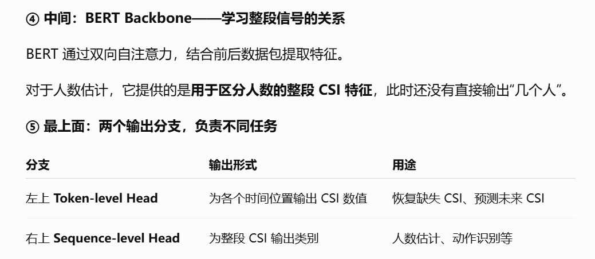

# CSI-BERT2: A BERT-inspired Framework for Efficient CSI Prediction and Classification in Wireless Communication and Sensing

统一支持 CSI 恢复、未来预测与感知分类，重点记录 ARL、时间嵌入和掩码训练。

> 根据上传的 Word 阅读笔记整理，保留原有讲解、配图、表格和组会汇报内容。

[返回笔记目录](README.md)

## 阅读记录

相对于之前发出的CSI-BERT改进的地方：

**MPM 是“怎么训练模型预测未来”，DANN 是一种“对抗学习方法”。两者负责的事情不同。**

**① MPM：Mask Prediction Model，掩码预测模型**

这是 CSI-BERT2 用来训练**未来 CSI 预测**的方法。

普通随机掩码恢复：

> 输入：A、？、C、？、E  
> 任务：根据前后信息，补出B、D。

MPM则**只遮住末尾一段**：

> 输入：A、B、C、？、？  
> 任务：根据前面的信号，预测后面的D、E。

这里A～E代表不同时刻的 CSI 数据包。

**所以，MPM主要改变的是遮挡位置和训练目标，不是另外增加一个网络模块。** 论文测试时用前0.8秒预测后0.2秒。

**② DANN：Domain-Adversarial Neural Network，域对抗神经网络**

它通常包含**特征提取网络和域判别器**：

- **判别器：** 尝试判断特征来自哪个数据域。

- **特征提取网络：** 学习让判别器难以区分来源的特征。

例如，判别器想分辨“这些特征来自房间A还是房间B”，特征提取网络则尝试保留两边共有的信息、减少环境差异。**这只是解释DANN机制的例子，不是说前作一定做了这个房间实验。**

实现这种“较劲”的关键是**梯度反转层**：反向传播时，把判别器传给特征提取网络的梯度反向。

在前作 CSI-BERT 中，作者采用了 **DANN式对抗训练**辅助信号恢复；CSI-BERT2将其改为 **GAN式训练**：判别器区分真实和恢复的 CSI，恢复器努力生成更真实的信号。

| **名称** | **在论文中的角色**       | **最简单的理解**                       |
|----------|--------------------------|----------------------------------------|
| **MPM**  | 第二篇的未来预测训练方法 | 遮住后面，让模型预测后面               |
| **DANN** | 前作采用的对抗学习方式   | 判别器努力区分，特征网络努力让它分不清 |
| **GAN**  | 第二篇采用的对抗学习方式 | 判别器辨真假，恢复器努力恢复得更像真的 |

CSI-BERT2 没有先做 Widar3.0 那种物理运动特征提取，而是把 CSI 序列交给网络学习。

Csi：包含信息 幅度，相位

过程:发送端发出已知信号 → 信号经过环境传播 → 接收端收到信号 → 对比发送与接收信号 → 估计 CSI。

### Fig1：**一个数据包里包含多个子载波的 CSI 数值。** 连续采集很多个数据包，就得到一段随时间变化的 CSI。

**① Standardization Layer：**标准化，让变化更容易被比较

不同子载波的数值大小可能差别很大

通俗来说：

- **减去均值：** 去掉这段信号的整体高低。

- **除以标准差：** 调整波动的尺度。

这样，上面 A、B 标准化后的变化模式就会相同，模型更容易发现它们具有相似的变化规律。

**这个模块是在调整数值，不是在识别人数，也不等于去掉所有噪声。**

**② ARL：给不同子载波分配“关注程度”**

**③ Linear Layer：**把一个数据包整理成一个特征向量

CSI 数值 → 线性层映射成向量 → Transformer

补充知识

Token：

一个词元 → 数字编号（Token ID）→ 数字向量（Token Embedding）→ Transformer

• **数字编号：** 像身份证号，用来查找对应的向量。

• **向量：** 一组数字，真正参与 Transformer 的计算。

文字例子：假设分词器把“我爱你”拆成三个 Token：

| **Token** | **数字编号 Token ID** | **查表得到的向量**      |
|-----------|-----------------------|-------------------------|
| 我        | 12                    | \[0.2, 0.5, −0.1, 0.8\] |
| 爱        | 35                    | \[0.7, −0.3, 0.4, 0.1\] |
| 你        | 68                    | \[−0.2, 0.6, 0.9, 0.3\] |

右边部分

这部分是在给每个 CSI Token 加上“顺序和时间标记”，让 BERT 知道这些信号是按什么顺序、隔多久采集的。

**进入 BERT Backbone 之前**：把对应的三种向量相加。

例如，第1个 Token：

第2个 Token 同样加入自己的时间和位置向量，以此类推。

**所以，右侧两路编码最终加到左侧 Linear Layer 输出的每一个 Token 上，再一起送入 BERT。图中没有把每个 Token 的相加过程逐一画出来。**

左下从下到上第二个Linear Layer里写的 T_1、T_2、T_3，是**给读图的人看的编号**，不会自动变成向量中的信息。

数据虽然按顺序放进去了，但 **BERT 的自注意力本身不会自动把排列位置理解成“第几个”**，所以需要：

- **位置嵌入：** 告诉模型“这是第几个”。

- **时间嵌入：** 告诉模型“它对应什么采集时间”。

这样，顺序和时间才明确地进入模型计算。

**Fig2讲的是：同一个 CSI-BERT2 框架，如何用于“恢复信号、预测信号、感知分类”这三件事。** 图1讲内部结构，图2讲使用方式。

**① 图2(a)：CSI Recovery——恢复信号，也是预训练任务**

流程是：

**随机遮住部分 CSI → CSI-BERT2 恢复 → 与原始信号比较。**

图中红色区域表示被遮住的数据。模型根据剩余信号，预测这些位置原本的 CSI。

旁边的 **Discriminator（判别器）** 负责区分真实 CSI 和恢复出的 CSI，推动模型生成更接近真实信号的结果。

**这一部分主要让模型学习 CSI 的规律，不需要人数或动作标签。**

**② 图2(b)：CSI Prediction——预测未来信号**

流程是：

**输入过去的 CSI → CSI-BERT2 → 输出未来的 CSI。**

它与(a)的关键区别是：

- **(a)：** 遮住序列中的随机位置，利用上下文恢复。

- **(b)：** 遮住序列末尾，根据前面的信号预测后面。

图右侧的基站、反馈箭头说明用途：提前预测信道变化，为通信系统优化提供依据。**这一部分预测的是信号，不是未来人数。**

**③ 图2(c)：CSI Classification——根据信号判断类别**

图中展示的是**画圈手势识别**：

**画圈时采集的 CSI → CSI-BERT2 → 输出“画圈”。**

上方两段 CSI 分别标着 **\\m\\ Hz、\\n\\ Hz**，表示采样率不同。作者想强调：**采样密度不同，同一个动作仍应识别成相同类别。**

人数估计也属于这一分支，只需把类别换成：

**CSI → CSI-BERT2 → 0人、1人、2人或3人。**

| **子图** | **模型最终输出什么** | **主要目的**               |
|----------|----------------------|----------------------------|
| **(a)**  | 被遮住位置的 CSI     | 学习信号规律、恢复缺失数据 |
| **(b)**  | 未来一段 CSI         | 预测信道变化               |
| **(c)**  | 动作、人数等类别     | 完成感知任务               |

**注意，这三个子图不是必须依次执行的三道工序。** 做人数估计时，是先通过(a)预训练，再训练(c)的人数分类头；不需要先经过(b)预测未来信号

### Fig3：同一段短时间的 CSI，即使随机丢掉一些数据包，各子载波的均值和标准差也可能保持比较稳定

|          | **图3(a)：Average**          | **图3(b)：Standard Deviation** |
|----------|------------------------------|--------------------------------|
| 横轴     | 子载波编号                   | 子载波编号                     |
| 纵轴     | CSI幅度的平均值              | CSI幅度的标准差，即波动程度    |
| 不同曲线 | 抽取不同数量数据包得到的结果 | 抽取不同数量数据包得到的结果   |

图2De-standardization 就是“反标准化”，把标准化后的数值还原到原来的尺度。**同一段较短时间内、随机缺失部分数据包**。如果连续丢失很长一段，或者恰好丢掉信号变化最大的部分，统计量就可能明显偏离。

**开场：这篇论文研究什么？约1分钟**

> 今天汇报的是 CSI-BERT2，研究的是如何利用 BERT 结构处理无线信道状态信息，也就是 CSI。
>
> 实际无线感知中存在数据包丢失、标注数据有限，以及训练和测试采样率不同等问题。作者希望通过一个统一框架，同时支持缺失 CSI 恢复、未来 CSI 预测，以及动作识别、人数估计等分类任务。
>
> 我主要介绍它如何编码 CSI、如何通过掩码进行训练，以及这些设计对感知任务有没有帮助。

这里可以简单补一句 CSI 背景：

> CSI 是接收端根据已知发送信号和实际接收信号，估计出的信道信息。人体会改变信号传播，因此人数和动作的变化会反映到 CSI 中。

不用在开场详细讲子载波原理，听众问到再展开。

**2．先讲图2：让大家知道模型在做什么，约2分钟**

建议**先图2、后图1**，更容易让听众跟上。

指着图2(a)讲：

> 第一种用法是恢复 CSI。作者随机遮住一些数据包，让模型根据其余信息恢复原始信号。这也是预训练任务，答案来自原始数据本身，不需要人数或动作标签。
>
> 此外，引入判别器区分真实和恢复的 CSI，促使恢复结果更接近真实信号。

指着图2(b)讲：

> 第二种用法是预测未来。将随机遮挡改为遮住序列末尾，使模型根据历史信号一次预测后续信号，这个训练方式称为 MPM。实验中使用前0.8秒预测后0.2秒。

指着图2(c)讲：

> 第三种用法是分类。模型输入一段 CSI，输出对应的动作或人数类别。图中以画圈手势为例，两边采样率不同，但希望识别结果一致。
>
> 对人数估计来说，输出类别就是0、1、2、3人。

然后强调：

> 这三种用法不是依次执行的流水线。做人数估计时，可以先进行恢复预训练，再训练人数分类头，不需要先预测未来 CSI。

**3．重点讲图1：模型怎么处理 CSI，约4分钟**

按图从下往上讲。

**先指左下角彩色矩阵：**

> 输入是一段 CSI 序列。横轴是按时间排列的数据包，纵轴是子载波。每一列代表一个时刻的子载波数据，每一行反映某个子载波随时间的变化。

**再指左侧编码模块：**

> 数据首先进行标准化，调整不同子载波的数值尺度。
>
> 随后经过 ARL，自适应地给不同子载波分配权重，突出有用信息。
>
> 最后通过特征映射，将每个时刻的数据转换成一个向量，也就是一个 Token。

这里用一句话解释 Token 就够了：

> 这里的 Token 是一个时刻的 CSI 特征向量，不对应一个人，也不需要转换成文字。

**再指右侧编码模块：**

> 仅有信号特征，还不能明确表达采集顺序和时间关系，因此加入位置嵌入和时间嵌入。
>
> 位置嵌入标记第几个数据包；时间嵌入根据时间戳构建，提供时间关系。作者在时间编码后增加 MLP，增强时间信息的表达。

**指中间 BERT Backbone：**

> 这些特征结合后输入 BERT 主干。它通过双向自注意力，让每个时刻结合前后其他时刻的信息，学习 CSI 的时序关系。论文采用6层编码器，每层8个注意力头。

不必详细推导 Q、K、V，除非组会要求解释注意力公式。

**最后指顶部两个分支：**

> 左侧 Token级输出头，为各个时间位置输出 CSI，用于恢复和预测；右侧序列级输出头，对整段特征进行聚合，输出动作或人数类别。
>
> 因此，两个输出头能够支持三种任务：恢复与预测共用 CSI 数值输出这一形式。

讲完后点出贡献：

> 相比前作 CSI-BERT，输入结构的两个主要改进对应图中的红星：新增 ARL，以及增强时间嵌入。训练方面还将对抗学习改为 GAN方式，并加入 MPM预测训练和分类随机掩码策略。

[返回笔记目录](README.md) · [返回科研主页](../README.md)
