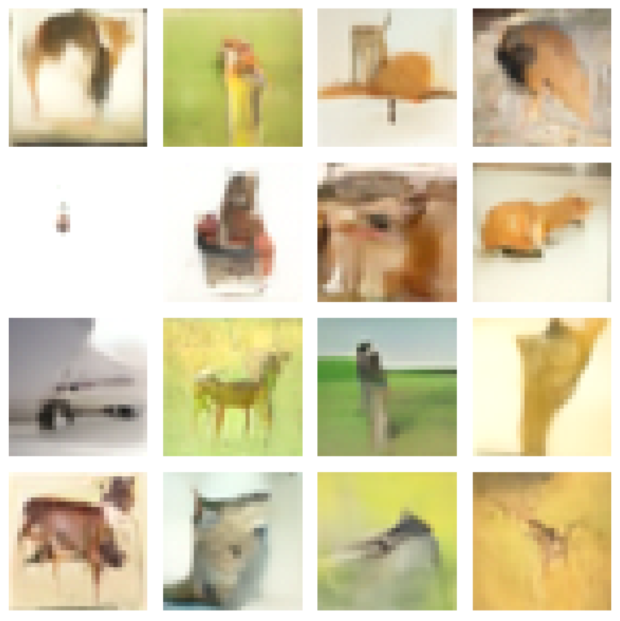

# DDIM · CIFAR-10 采样复现

> 本目录单独记录 DDIM 采样实验。它在已经训练好的 DDPM 基础上进行，不另行训练 U-Net。

[← 代码复现总览](../../README.md) · [DDPM 训练记录](../../01-ddpm-cifar10/)

## 1. 实验介绍

在完成 DDPM 的 CIFAR-10 训练后，我尝试复用训练好的噪声预测网络权重，将原始采样方法替换为 DDIM 采样方法，研究生成过程中的采样步骤。

参考论文：[Denoising Diffusion Implicit Models（ICLR 2021）](https://arxiv.org/abs/2010.02502)

## 2. 与 DDPM 的关系

- **保持不变：** CIFAR-10 图像大小、U-Net 结构、复用已有 DDPM 权重的方式，以及 16 张图片的可视化方式。
- **发生改变：** 采样脚本从 `ddpm.sample()` 改为 `ddpm.ddim_sample(..., steps=50)`。
- **不需要：** 为了切换 DDIM 采样而重新训练 U-Net。

DDIM 的核心变化在于反向采样过程，而不是重新设计噪声预测网络。

## 3. 核心代码改动

DDPM 采样：

```python
imgs = ddpm.sample(
    shape=(16, 3, 32, 32),
    device=device
)
```

DDIM 采样：

```python
imgs = ddpm.ddim_sample(
    shape=(16, 3, 32, 32),
    device=device,
    steps=50
)
```

**注意：** 上述代码展示的是采样函数的**调用变化**；DDIM 算法的具体实现位于 `ddpm.py` 的 `ddim_sample()` 中，尚需进一步检查时间步序列与反向更新公式。

## 4. 实验配置

| 参数 | 设置 |
|---|---|
| 数据集 | CIFAR-10 |
| U-Net 基础通道数 | 64 |
| 通道倍率 | (1, 2, 4) |
| 残差块数量 | 2 |
| 图片大小 | 3 × 32 × 32 |
| 模型扩散时间步 | 1000 |
| DDIM 指定的采样步数 | 50 |
| 生成图片数量 | 16 |
| 使用权重 | 复用 DDPM 模型权重（当前采样脚本的 checkpoint 版本待确认） |
| 是否重新训练 | 否 |

## 5. 采样结果



