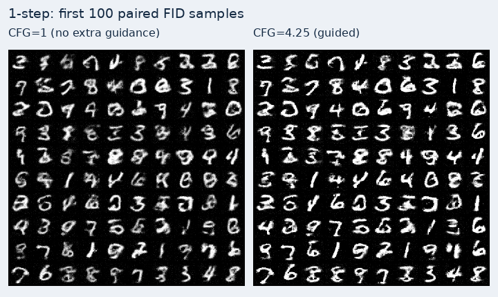
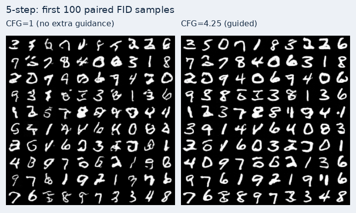
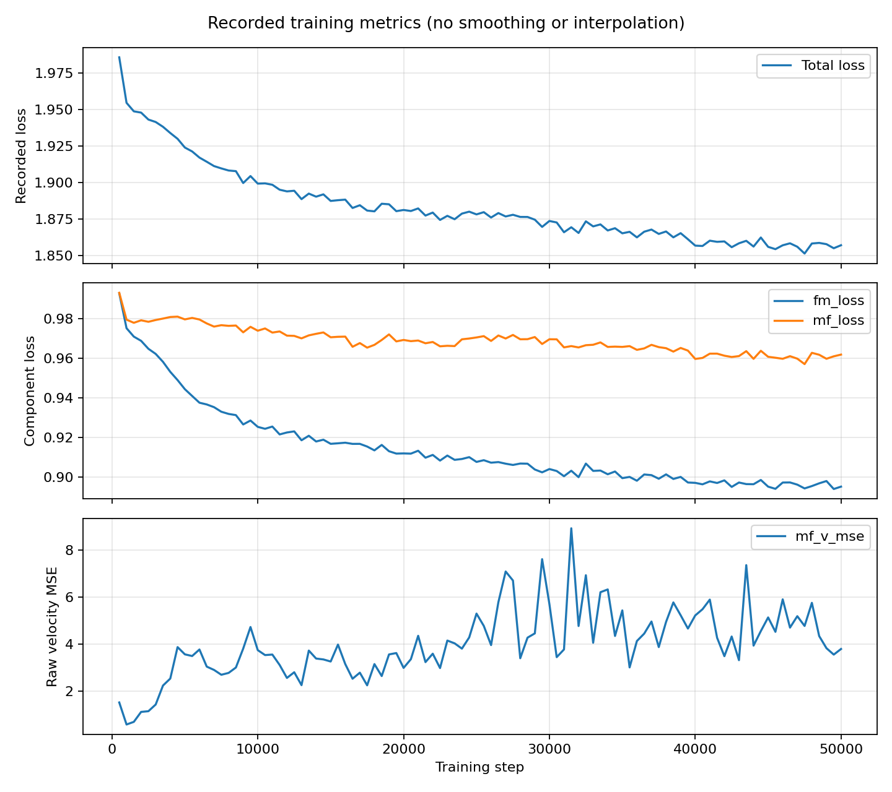

# MeanFlow / iMF · MNIST 

基于 [haidog-yaqub/MeanFlow](https://github.com/haidog-yaqub/MeanFlow) 的第三方 PyTorch 实现，复现「训练平均速度模型 → 保存权重 → 一步生成」的完整流程。默认采用该仓库当前的 `i-meanflow` 模式，以 MNIST 为入门数据集。


## 实测结果与生成图片

| 采样 | 模型调用次数（NFE） | FID ↓ |
|---|---:|---:|
| 一步（核心结果） | 1 | **179.8574** |
| 五步（补充对照） | 5 | **17.9291** |

评估使用上传的 `step_0050000.pt`：每种采样 10,000 张生成图，对比 10,000 张 MNIST test 图片；CFG=1，CPU / FP32。[完整评估记录](results/uploaded-step-0050000-cfg1/) · [原始 FID JSON](results/uploaded-step-0050000-cfg1/fid.json)。

MeanFlow 的核心目标是一步生成；五步用于质量对照，五步的较低 FID 不能证明一步高质量生成已复现成功。FID 越低表示这里采用的 Inception 特征分布越接近，不可直接和不同数据集或协议的分数比较。

下面每张网格展示对应评估最先生成的 100 张图片，不是全部 10,000 张。两种采样使用相同类别与初始噪声，类别顺序随机固定。

**一步生成：**


**五步生成（补充对照）：**


## CFG 与无额外引导的对照

同一权重、相同初始噪声和数字类别；每个设置 10,000 张生成图，对比同一组 10,000 张 MNIST test。两组都保留数字类别条件，只有引导强度不同。

| 采样 | 无额外引导 CFG=1，FID ↓ | 有引导 CFG=4.25，FID ↓ |
|---|---:|---:|
| 1 步 | 179.8574 | 150.9314 |
| 5 步 | 17.9291 | 35.2649 |

**这次 CFG=4.25 改善了一步 FID，但使五步 FID 变差。** 一步降低 16.08%；五步升高 96.69%。图像轮廓看起来更清晰，不等于整体分布与真实数据更接近；本次未单独测类别准确率或多样性，不能据此推断原因。

一步并排图片，左侧 CFG=1，右侧 CFG=4.25：



五步并排图片：



[完整对照结果、过程动图、协议与复测命令](results/uploaded-step-0050000-cfg-comparison/)。

这里比较同一个模型的**推理引导设置**，没有分别训练“有 CFG 蒸馏 / 无 CFG 蒸馏”的两个模型。该权重已把 CFG 学入模型，改变 w 后仍只需 1 / 5 次模型调用。

## 一步与五步生成过程

使用同一个上传权重、CFG=1、相同初始噪声，固定展示数字类别 0–9。这里是额外生成的 10 个过程示例，不是上面 10,000 张 FID 评估图的逐帧记录。

**一步：噪声 → 最终图。** 模型只调用一次，动图只有初始噪声和最终输出两种状态。


**五步：噪声 → 五次模型更新 → 最终图。** 动图保存全部六种实际状态；播放停留时间仅用于观看，不代表真实计算耗时。


[一步静态过程图](results/uploaded-step-0050000-process/process_1step.png) · [五步静态过程图](results/uploaded-step-0050000-process/process_5step.png) · [原理、设置与复测命令](results/uploaded-step-0050000-process/)。

## 1. 来源与复现范围

- 原论文：[Mean Flows for One-step Generative Modeling](https://arxiv.org/abs/2505.13447)。
- 后续论文：[Improved Mean Flows](https://arxiv.org/abs/2512.02012)。
- 参考代码：上述第三方仓库，固定 commit `97cc5182abe9d69e5dcb350268f603fbe31a5897`。
- 保留参考实现的 `meanflow.py`、`models/dit.py`、`data.py`、`train.py` 和原始 MNIST/CIFAR-10 配置，保留其 [MIT 许可](LICENSE)。参考源码不是本项目独立原创。
- 新增 `train_repro.py`、`sample_repro.py`、`repro_utils.py`、笔记本配置和流程验证脚本。

本实验是**第三方实现的流程复现**，不声明达到论文的 ImageNet FID 或原论文严格复现。当前参考代码使用双头 DiT、额外 FM loss，以及其自身的 JVP 计算方案。特别地，当前 `meanflow` 与 `i-meanflow` 两个分支在 `dudt` 被 detach 的处理下，其损失表达式代数等价；仅切换模式字符串不能作为原 MeanFlow 与 iMF 的有效对照实验。

## 2. 先跑 MNIST

先进行 100 step 的真实 MNIST 检查，然后从头训练 10,000 step：

| 设置 | 配置 | 上游 MNIST 配置 |
|---|---|---|
| 图片 | MNIST，1 × 32 × 32 | 同左 |
| 模型 | DiT，dim=256，depth=6 | DiT，dim=512，depth=12 |
| Patch size | 4 | 2 |
| Batch size | 32 | 64 |
| 总训练 step | 10,000 | 200,000 |
| Learning rate | 1e-4 | 1e-4 |
| Warmup step | 500 | 2,500 |
| 精度 | BF16；可选 FP32 | BF16 |
| CFG 蒸馏 | 关闭；仍使用数字类别条件 | CFG 范围 [1.0, 7.5] |
| DataLoader workers | 0，适合先排查 Windows 流程 | 8 |


## 3. Loss保存和恢复

新增脚本默认每 100 step 记录一次真实区间平均 Loss，每 500 step 保存 checkpoint 和一步样本。输出内容：

- `config.json`：实际采用的配置，包括命令行覆盖。
- `environment.json`：PyTorch、依赖版本、设备、精度、随机种子和代码来源。
- `loss.csv`：真实训练区间的 step、区间长度、Loss、FM/MF loss、原始速度 MSE、学习率和梯度范数。
- `loss_curve.png`：真实区间平均 Loss 与原始 MF 速度 MSE 曲线。
- `images/step_0000500_1step.png`：固定噪声、固定类别的一步采样网格。
- `ckpts/step_0000500.pt`：模型、优化器、scheduler、step、Loss 历史及随机数状态。

### 本次上传权重的 Loss 曲线

2026-10-11 补充上传的 `train.log` 与 `config.py` 标注运行 `mnist_meanflow_50k`、模式 `meanflow`，训练配置为 50,000 step、batch=2、BF16。模型结构、max_cfg=7.5 与 minmax 归一化和本次评估设置一致。

日志每 500 step 记录一次区间平均指标：从 step 500 到 50,000，共 100 个记录点，按配置的记录间隔没有缺失。首个总 Loss 为 **1.985971**，末个为 **1.856935**；FM Loss 从 **0.992869** 到 **0.895081**，MF Loss 从 **0.993101** 到 **0.961854**。



曲线上方为总 Loss，中间为 FM/MF 分项，下方为原始 MF 速度 MSE；分开展示避免尺度混淆。数据不平滑，不补造记录。原始 MSE 有明显波动，不能只凭总 Loss 下降判定一步生成效果，需结合上面的 FID 和生成图。

[训练记录与解读](results/mnist-meanflow-50k-training/) · [原日志](results/mnist-meanflow-50k-training/train.log) · [训练配置](results/mnist-meanflow-50k-training/config.py) · [Loss CSV](results/mnist-meanflow-50k-training/loss.csv)。

使用 [plot_training_loss.py](plot_training_loss.py) 可从已保存的日志重新绘图，无需重新训练：

```bat
python plot_training_loss.py --input results/mnist-meanflow-50k-training/train.log --out results/loss-replot
```

## 4. 一步生成与耗时记录

```bat
python sample_repro.py --checkpoint runs/mnist_first/ckpts/step_0010000.pt --sample-steps 1 5 --out samples/mnist_compare
```

默认每类生成 10 张，共 100 张；一行依次为数字 0–9。输出 `samples_1step.png`、`samples_5step.png` 和 `timing.json`。两种采样使用相同类别与初始噪声，默认 CFG scale=1。


### FID：完整训练后直接评估

评估协议：

- 后端为 [torch-fidelity 0.3.0](https://torch-fidelity.readthedocs.io/en/v0.3.0/api.html)，`inception-v3-compat` 的 **2048 维**特征，特征提取采用 FP32。
- 默认真实参考集为 MNIST/CIFAR-10 **test** 划分；`--split train` 可改变划分，结果必须注明。真实样本不做随机翻转。
- MNIST 真实图片先按模型输入大小做 PIL 双线性缩放；灰度图复制为三个 RGB 通道。生成图先限制在 [0,1]，再按 `round(255*x)` 转成 uint8；两组均交由库内部缩放到 299 后提取特征。
- 固定随机种子，生成类别数量与选中参考集的类别分布相同；一步/五步使用相同初始噪声。默认 CFG scale=1、生成 FP32，可通过参数明确改变并记录。
- 结果写入 `fid_results/.../fid.json`：包含权重 SHA256、训练 step、参考样本索引、样本数、采样步数、精度、依赖版本与各次 FID；同时保存预览图。
- 显存不足可调小 `--batch-size 16 --fid-batch-size 16`。`--cpu` 可以运行，但完整评估会较慢。


[← 返回复现总览](../README.md)
