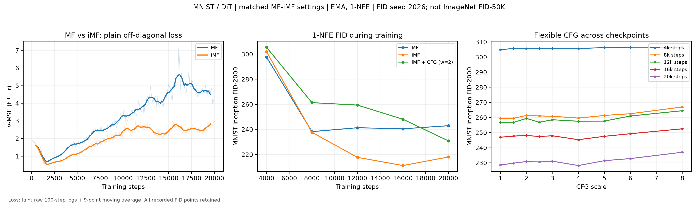

# 03 · MNIST / DiT：MF、iMF 与 flexible CFG

**状态：MF、iMF、CFG 各完成 20,000 步，真实 loss、FID 和 CFG 曲线已上传。**

本项目是 MNIST 方法级对比。iMF 的 FID 低于 MF，但 loss 未复现论文的持续下降；CFG 未优于单独 iMF，类别控制仍然较弱。



## 实测结果

统一使用 EMA、1-NFE、seed=2026。最终指标使用 FID 专用 Inception-v3 pool3 2048 维、完整 MNIST test 10,000 张参考图和 10,000 张生成图。

| 模型 | 最终 FID-10000 ↓ | 最后 1,000 步 t≠r loss | 类别一致率 ↑ |
|---|---:|---:|---:|
| MF | 237.38 | 4.5237 | 12.88% |
| iMF | **211.80** | **2.7897** | 11.34% |
| iMF-CFG（ω=4，扫描最优） | 222.73 | 5.9071* | 10.74% |

iMF 最终 FID 比 MF 低约 10.8%。*CFG 的训练目标不同，loss 不能与无 CFG 两组直接比较。类别一致率来自 test 准确率 98.68% 的独立 MNIST 分类器；其特征距离单独记录，不当作 Inception FID。

训练过程曲线统一使用 FID-2000，最终复核使用 FID-10000，两个样本量的结果分开保存。论文的 ImageNet 256×256 FID-50K 与这里的数据、模型规模和训练预算不同，数值不能直接比较。

- [完整结果汇总](results/dit_stable/结果汇总.md)
- [实验配置与已处理问题](results/dit_stable/实验说明.md)
- [训练过程 FID / CFG 原始指标](results/dit_stable/fid_history.csv)：5 阶段、55 条记录
- [最终 FID-10000 扫描](results/dit_stable/fid10000/fid_history.csv)：11 条记录
- [MF 训练日志](results/dit_stable/mf_train.csv)、[iMF 训练日志](results/dit_stable/imf_train.csv)、[CFG 训练日志](results/dit_stable/imf_cfg_train.csv)
- [一步生成对比](results/dit_stable/mf_vs_imf_dit.png)、[CFG 生成图](results/dit_stable/cfg_scales_dit.png)
- [完整性核验](results/dit_stable/validation.json)
- [可缩放矢量曲线](results/dit_stable/comparison_curves.svg)

## 训练设置

原项目 MFDiT：MNIST 32×32，dim=256，depth=6，heads=8，patch=4，batch=64。MF/iMF 使用相同初始化种子 42、模型及优化器；两者都使用普通 v-MSE，仅绘制 t≠r 样本，不加 CFG、adaptive weighting 或辅助头损失。

MF 的 JVP 方向为 e−x，iMF 为边界速度 u(z,t,t)。CFG 独立使用论文 Algorithm 2 的边界方案，p(ω)∝1/ω，ω∈[1,8]，类别丢弃率 0.1；条件和无条件分支使用同一 ω，没有 CFG interval conditioning。

优化器 β=(0.9,0.95)，weight decay=0，峰值 lr=2e−5，warmup=2,000，固定 20k 余弦计划，最低 lr 比例 0.2，梯度裁剪 1，EMA=0.999。MF/iMF 从已有 4k 权重续训；恢复时数据 shuffle 迭代器重启，不保证逐位一致。

## 安装与运行

在本目录运行命令。先安装适配 NVIDIA 显卡的 CUDA PyTorch，再安装依赖，建议使用独立 Python 环境：

```sh
python -m pip install -r requirements.txt
python code/smoke_test.py
```

分阶段训练并保留 4k/8k/12k/16k/20k 权重，自动生成 FID-2000 曲线、训练日志和分类器指标：

```sh
python code/continue_experiments.py
```

该脚本支持读取已有 checkpoint 续训，新实验结果写入 `results/new_run/`，保留已上传的原始结果。本次训练权重和 MNIST 数据遵循仓库忽略规则保留在实验机器，不包含在 Git 中。重新训练后可执行：

```sh
python code/plot_results.py --device cuda --results results/new_run
python code/final_figures.py --results results/new_run
python code/fid_curve.py --runs-root runs_dit_stable --data-root data --results results/new_run --samples 2000
python code/fid_curve.py --runs-root runs_dit_stable --data-root data --results results/new_run/fid10000 --steps 20000 --samples 10000
```

已上传的 CSV 是本轮原始结果。开展新实验时请使用新的结果目录或先备份结果，避免与原始记录混用；FID 脚本会跳过相同阶段、尺度、样本量的已记录条目。

评估需要 CUDA。Inception 权重及参考统计缓存在项目 `work/`；首次使用需联网下载 Inception 权重。奇异协方差使用等价的对称 PSD 公式，已验证与标准开方公式一致；未启用重复 OpenMP 运行时绕过选项。

`legacy_unet/` 仅为旧 U-Net 代码存档。本轮使用 `code/models/dit.py`。

参考：[Improved Mean Flows 论文与 Algorithm 1/2](https://arxiv.org/html/2512.02012v1)、[原第三方 PyTorch 实现](https://github.com/haidog-yaqub/MeanFlow)、[pytorch-fid](https://github.com/mseitzer/pytorch-fid)。上游许可见 [UPSTREAM_LICENSE](UPSTREAM_LICENSE)。
