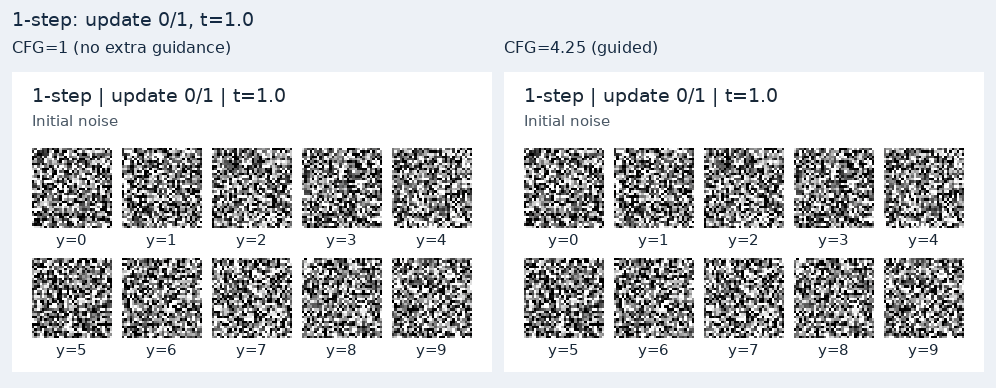
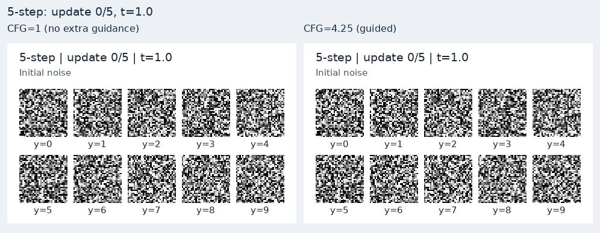

# 有 CFG 与无额外 CFG 引导的对照实验

使用同一个用户上传的 `step_0050000.pt`，仅改变推理引导强度。**CFG=1 为无额外引导，CFG=4.25 为有引导；两组都保留数字类别条件。** 不重新训练模型。

## FID 实测

| 采样 | NFE | CFG=1，FID ↓ | CFG=4.25，FID ↓ | 差值（有−无） |
|---|---:|---:|---:|---:|
| 1 步 | 1 | 179.8574 | 150.9314 | -28.9260 |
| 5 步 | 5 | 17.9291 | 35.2649 | +17.3357 |

差值为负表示本次有引导的 FID 更低。每个设置都使用 10,000 张生成图，对比同一组 10,000 张 MNIST test 真实图片。

- 1 步：CFG=4.25 的 FID 比 CFG=1 降低 28.9260，相对变化 16.08%。
- 5 步：CFG=4.25 的 FID 比 CFG=1 升高 17.3357，相对变化 96.69%。

本次 CFG=4.25 改善一步 FID，却使五步 FID 变差。图像轮廓更清晰不等于整体分布更接近；本次没有单独量化类别准确率或多样性，不能把 FID 变化归因于某一原因。

这比较的是**同一个已训练权重的推理设置**，不是“训练时有 CFG 蒸馏”和“训练时关闭 CFG 蒸馏”的两模型消融实验。该权重在训练时接收 w∈[1,7.5]，w=4.25 是原训练预览使用的区间中点。模型接收 w 后单次预测已经包含引导，因此有 CFG 仍为 1 / 5 NFE，没有另外调用无条件分支。

FID 描述 Inception 特征中的分布差异；更低分数不能单独证明类别正确或多样性不变。本实验只比较 w=1 与 4.25，没有搜索最佳 CFG 值，也不把 MNIST 分数与其他数据集的论文分数直接比较。

## 公平对照设置

- 权重、32×32 输入、minmax 归一化和目标类别序列完全相同。
- 真实参考种子 42、生成噪声种子 43；一步/五步、CFG=1/4.25 都重置生成器，使用相同噪声与类别。
- 每个设置 10,000 张；生成 batch=32、特征 batch=64。
- CPU / FP32 / 8 线程；SDPA attention；Inception channels-last。
- torch-fidelity 0.3.0，Inception-v3-compat 2048 维；特征权重 SHA256 完全相同。
- 已逐项核对真实图片哈希、参考索引、类别数量、精度、预处理与特征设置一致；只有 CFG scale 改变。
- CFG=1 使用先前保存的完整实测记录；CFG=4.25 本次重新生成并评估。原真实统计缓存已丢失，本次重新计算，参考图与特征权重哈希一致。

## 正式评估前 100 张图片

每图左侧 CFG=1，右侧 CFG=4.25；位置一一对应。这些是 FID 评估最先生成的 100 张，不是挑选的最好样本。

一步：


五步：


## 相同噪声的生成过程

下面固定展示目标类别 0–9 各一张，属于独立过程示例。图中的 y 为目标类别，不能当作输出分类判定。

一步：两种真实状态，模型各调用一次。



五步：六种真实状态，模型各调用五次。



动图只延长真实状态的观看时间，不插值制造中间状态，不代表真实采样耗时。[一步固定类别最终图](compare_fixed10_1step.png) / [五步固定类别最终图](compare_fixed10_5step.png)。

## 数据与复测

[对比汇总 JSON](comparison.json) · [CFG=1 原协议](../uploaded-step-0050000-cfg1/fid.json) · [CFG=4.25 完整协议](fid_cfg425.json) · [真实训练配置和 Loss](../mnist-meanflow-50k-training/)。两组过程记录见 [CFG=1](process_cfg1.json) 和 [CFG=4.25](process_cfg425.json)。

从 `code/` 目录运行；将同一权重放进项目目录：

```bat
python eval_fid.py --checkpoint ../results/weights/step_0050000.pt --config configs/mnist_uploaded_50k.py --cfg-scale 1 --num-samples 10000 --sample-steps 1 5 --cpu --threads 8 --attention sdpa --feature-memory-format channels_last --batch-size 32 --fid-batch-size 64 --out ../results/fid_runs/cfg1_recheck
python eval_fid.py --checkpoint ../results/weights/step_0050000.pt --config configs/mnist_uploaded_50k.py --cfg-scale 4.25 --num-samples 10000 --sample-steps 1 5 --cpu --threads 8 --attention sdpa --feature-memory-format channels_last --batch-size 32 --fid-batch-size 64 --out ../results/fid_runs/cfg425_recheck
python visualize_sampling.py --checkpoint ../results/weights/step_0050000.pt --config ../results/mnist-meanflow-50k-training/config.py --cfg-scale 1 --cpu --out ../results/samples/process_cfg1
python visualize_sampling.py --checkpoint ../results/weights/step_0050000.pt --config ../results/mnist-meanflow-50k-training/config.py --cfg-scale 4.25 --cpu --out ../results/samples/process_cfg425
python compare_cfg_visuals.py --baseline-process ../results/samples/process_cfg1 --guided-process ../results/samples/process_cfg425 --baseline-fid ../results/fid_runs/cfg1_recheck --guided-fid ../results/fid_runs/cfg425_recheck --out ../results/cfg_recheck
```

默认预训练特征权重与本次显式下载的权重相同；可用 `--fid-weights` 指定相同本地文件。评估适配配置中的 mode 标签只用于构造采样器，不代表另一次训练；原日志与训练配置标注为 MeanFlow。输出目录应使用新的名称。

[返回复现首页](../../README.md)
