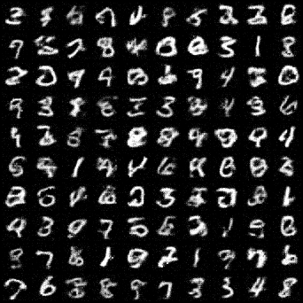
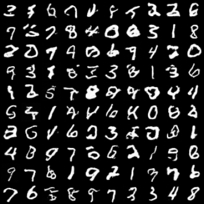

# 上传权重的 MNIST FID 实测

评估日期：2026-10-11。使用用户上传的 `step_0050000.pt`，不重新训练。FID 越低，表示该特征空间中两组图像的分布越接近。

| 采样 | NFE | FID |
|---|---:|---:|
| 一步 | 1 | 179.8574 |
| 五步 | 5 | 17.9291 |

## 评估协议

- MNIST test，10,000 张真实图与每种采样 10,000 张生成图；参考样本种子 42，噪声种子 43。
- CFG scale=1；一步/五步使用相同类别与初始噪声，类别数量按测试集分布设置。
- 真实灰度图通过 PIL 双线性缩放到 32×32 后复制为 RGB；生成图 clip 到 [0,1]、round(255*x) 转为 uint8。
- `torch-fidelity==0.3.0`、`inception-v3-compat`、2048 维特征，库内部缩放到 299×299。全部使用 FP32。
- 设备为 CPU，8 线程；生成 batch=32，特征 batch=64。采用等价的 SDPA attention 和 Inception channels-last 布局；具体依赖版本见 [fid.json](fid.json)。
- 参考统计按图片内容、特征权重、设备与布局缓存。模型加载与保存原始权重不作修改。

## 权重与结构

上传权重的 SHA256：`88a7a517315ff5445136671f54c8c44520eea90f19bdd82bf4334789bf4452e1`。

模型通过严格 state_dict 加载：32×32 灰度图、patch=2、dim=256、depth=6、heads=4、10 类，7,831,304 个参数。`max_cfg=7.5` 依据用户已有实验记录；minmax 归一化沿用参考 MNIST 实现。评估适配配置见 [mnist_uploaded_50k.py](../../configs/mnist_uploaded_50k.py)。

原文件仅含模型参数，未包含训练模式、累计 step 或优化器状态。文件名提示 50,000 step，但本记录不把文件名当作训练过程验证；iMF/MeanFlow 训练模式尚未由该权重确认。采样流程与此模式标签无关。

该分数为本协议下 MNIST 的 Inception FID，不能直接与使用 MNIST 分类器特征、60,000 张训练参考图、不同预处理，或 ImageNet/CIFAR-10 的 FID 比较。

## 复测

把相同权重放进项目目录，从 `03-meanflow-mnist` 运行：

```bat
python eval_fid.py --checkpoint step_0050000.pt --config configs/mnist_uploaded_50k.py --num-samples 10000 --sample-steps 1 5 --precision no --cpu --threads 8 --attention sdpa --feature-memory-format channels_last --batch-size 32 --fid-batch-size 64 --out fid_results/recheck
```

在 GPU 上运行可去掉 `--cpu`；应保留其余评估设置并记录设备变化。

## 样本预览

每图展示该评估中最先生成的 100 张，类别顺序按真实参考集的固定随机顺序排列，不是每行 0–9。

一步：



五步：



## 训练 Loss

目前没有收到该权重对应的原始 `train.log` / `loss.csv`，因此没有这次训练的 Loss 曲线。纯模型参数无法还原训练历史。[日志位置与绘图方法](../../README.md#本次上传权重的-loss-曲线)已整理；提供与权重同一次运行的训练日志和配置后，可生成并补齐真实曲线。

[← 返回实验说明](../../README.md)
