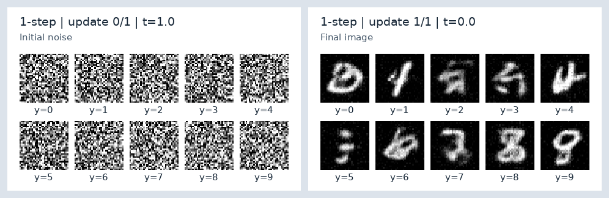
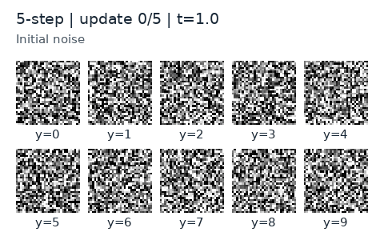
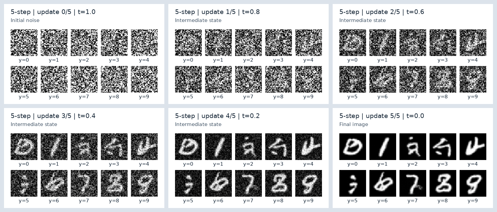

# 一步与五步生成过程可视化

使用 `step_0050000.pt` ，生成设备为 CPU / FP32，CFG=1，噪声种子 43。固定展示目标类别 0–9，各一张；两种采样复用完全相同的初始噪声。

## 一步生成

模型预测整个区间的平均速度，从噪声侧 t=1 一次更新到图像侧 t=0；只有一次模型调用、两种状态。GIF 没有加入虚构的逐渐变清晰过程。




## 五步生成（补充对照）

把相同区间分成五段，每段重新预测平均速度并更新图像状态：
t=1.0 → 0.8 → 0.6 → 0.4 → 0.2 → 0.0。





静态图按左到右、上到下阅读。图中的 `y` 是输入的目标数字类别，不是分类器对输出的判定。

## 如何读取与验证

- `update 0/N`：初始噪声。
- `update i/N`：已经完成 i 次真实模型更新；i=N 时为最终图。
- 本代码沿噪声侧 t=1 向图像侧 t=0 采样。每段执行 `z = z - u / N`，其中 u 是模型对该区间预测的平均速度。
- 保存的是同一次轨迹中的原始状态。仅在显示时执行 minmax 反归一化、clip[0,1]、round(255*x) 和最近邻放大；显示裁剪不会反馈给下一步采样。
- GIF 共 2 / 6 帧，只延长观看时间，不插值生成额外状态；播放时长不是采样性能测量。
- forward hook 验证模型调用次数确为 1 / 5。轨迹最终输出与现有 `repro_utils.generate` 的最大绝对差异均为 **0**。
- 这 10 个固定示例用于解释过程，不是 FID 评估样本集，也不代表整体生成质量。FID 仍按原先 10,000 张协议报告。

[process.json](process.json) 保存权重与配置哈希、噪声及各个原始状态哈希、时间点、模型调用次数和验证结果。原训练配置见 [config.py](../mnist-meanflow-50k-training/config.py)。

## 复测

把相同权重放进项目根目录，从 `03-meanflow-mnist/code` 运行：

```bat
python visualize_sampling.py --checkpoint ../results/weights/step_0050000.pt --config ../results/mnist-meanflow-50k-training/config.py --out ../results/process-recheck --cpu --threads 8
```

脚本见 [visualize_sampling.py](../../code/visualize_sampling.py)。在可用的 CUDA 环境运行可去掉 `--cpu`，但应记录设备变化。

[FID 与样本预览](../uploaded-step-0050000-cfg1/) · [真实训练 Loss](../mnist-meanflow-50k-training/) · [返回复现页面](../../README.md)
