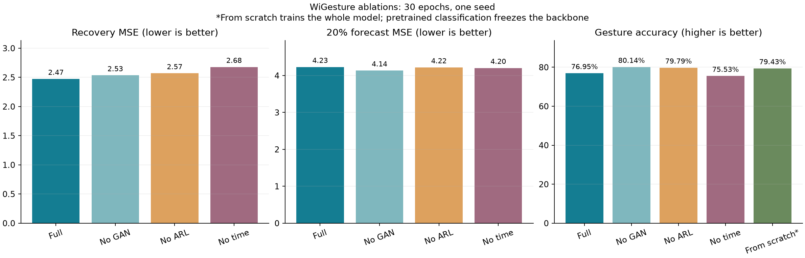

# CSI-BERT2

三个实测数据集的恢复、预测、分类、9 组循环网络基线及选定消融已完成。共 34 个任务模型、1020 个训练轮次记录，未完整达到论文指标。

[实验报告](results/REPORT.md) · [指标 CSV](results/runs/comparison.csv) · [模型](code/src/model.py) · [训练](code/run.py) · [推理](code/infer.py)

## 结果

| 数据集 | 恢复 MSE | 末尾20%预测 MSE |
|---|---:|---:|
| WiGesture | 2.4733 | 4.2316 |
| WiFall | 4.8549 | 5.1946 |
| WiCount | 4.2776 | 6.1009 |





每项 30 轮、seed=42。数据划分、裁窗和训练预算与论文不同；CommPre、混合采样率训练、全部基线与多种子实验尚未完成。预训练分类冻结主干，无预训练对照训练全网络，不能把差异仅归因于初始化。

恢复图中 `fill missing only` 仅补缺失，`reconstruct all` 全部使用模型输出。真实缺失处没有真值，误差由人为遮挡的有效位置计算。详细设置见实验报告。

## 运行与文件

在 code 目录创建 Python 环境，安装对应 CUDA PyTorch 后运行 `pip install -r requirements.txt`。本机验证环境为 Python3.14、PyTorch2.11+cu128、Transformers4.57.6。

数据准备：WiGesture 从 https://huggingface.co/datasets/RS2002/WiGesture 下载 WiGesture.zip，解压动态部分至 code/data/raw/dynamic，再运行 `python prepare_data.py`。其他数据：

```shell
python prepare_extra.py --dataset WiFall --download
python prepare_extra.py --dataset WiCount --download
python train_suite.py --epochs 30
python train_baselines.py --epochs 30
```

训练产生 code/runs 和 code/reports；本仓库 results 是已完成实验的静态快照。大型原始数据、环境和 .pth 权重未放入 Git，仍保存在本机 E:\all\CSI-BERT2-reproduction；已记录权重 SHA256 于 results/runs/completion_audit.json。推理/重新绘图需先把对应 runs 权重与处理数据放入 code 下，或重新训练。已有 PNG、JSON、CSV 无需训练即可查看。

来源：[作者代码](https://github.com/RS2002/CSI-BERT2) · [版本记录](code/source_revisions.json) · [论文](https://doi.org/10.1109/TMC.2025.3640420)

[返回复现目录](../README.md)
