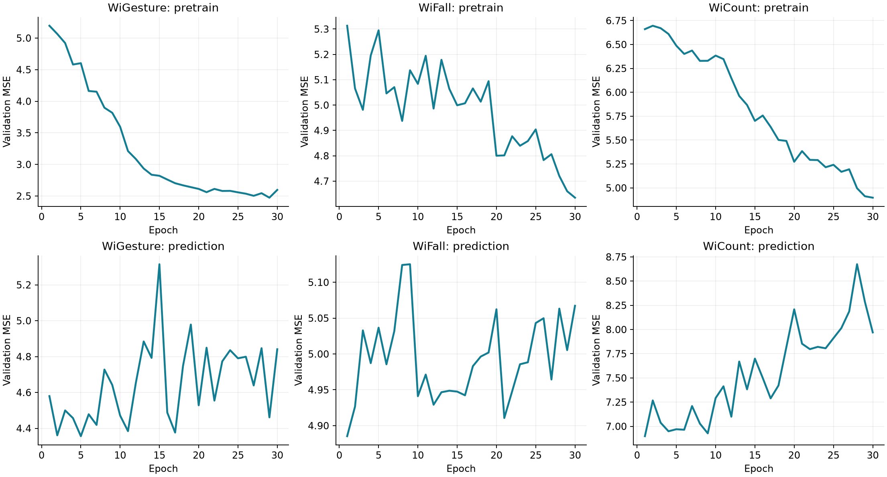
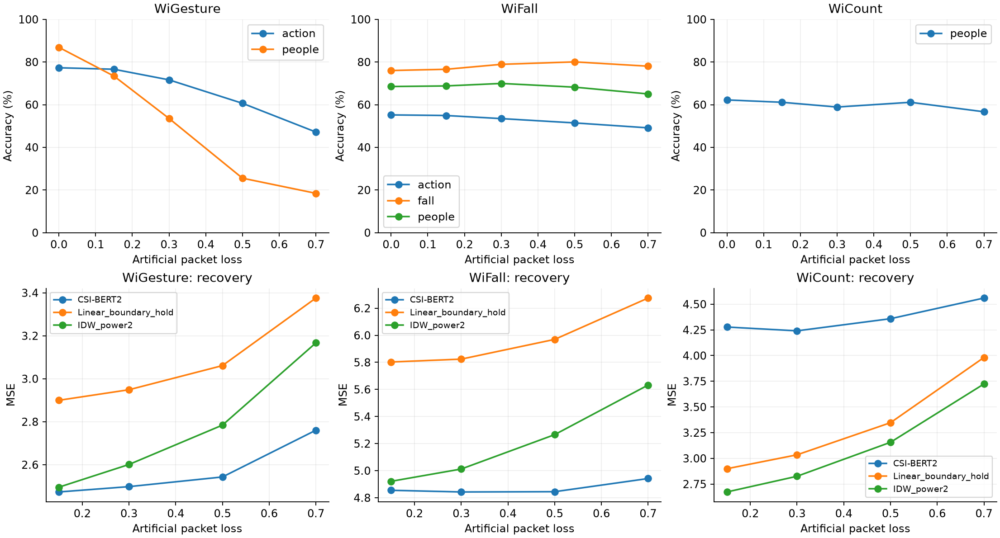
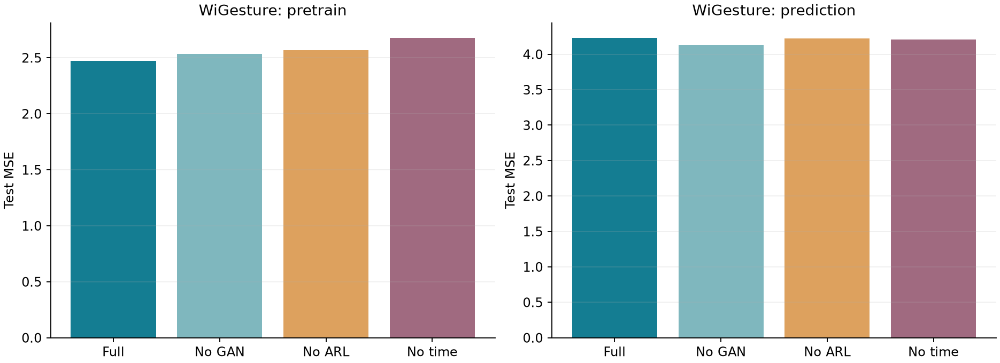

# 继续复现实验报告

本次在原项目中补充 WiFall、WiCount、论文比例的 WiGesture 重跑、四项消融/对照、循环网络预测基线和丢包鲁棒性评估。所有下表数字均来自本机实际运行，原始权重、配置、每轮日志和 JSON 结果均在 runs/。

## 三个真实数据集的主要结果

| 数据集 | 恢复 MSE（随机 15%） | 预测 MSE（末尾 20%） | 预测 SMAPE | 预测 MAPE |
|---|---:|---:|---:|---:|
| WiGesture | 2.4733 | 4.2316 | 0.1512 | 0.1740 |
| WiFall | 4.8549 | 5.1946 | 0.1403 | 0.1549 |
| WiCount | 4.2776 | 6.1009 | 0.1576 | 0.1870 |

| 数据集 | 任务 | 100Hz 准确率 | 宏平均 F1 | 100Hz 训练→50Hz 测试 | 测试样本数 |
|---|---|---:|---:|---:|---:|
| WiGesture | 动作/手势识别 | 76.95% | 0.7645 | 72.34% | 282 |
| WiGesture | 人员识别 | 87.59% | 0.8740 | 82.27% | 282 |
| WiFall | 动作/手势识别 | 55.49% | 0.4142 | 56.30% | 346 |
| WiFall | 跌倒检测 | 76.88% | 0.7684 | 78.99% | 346 |
| WiFall | 人员识别 | 67.92% | 0.3840 | 66.39% | 346 |
| WiCount | 人数估计 | 62.22% | 0.5672 | 64.44% | 90 |

WiFall 跌倒类（类别 0）的精确率为 67.38%，召回率为 86.90%，二分类平衡准确率为 78.27%。这些指标用于区分模型是否仅受类别比例影响。

公开 WiFall 压缩包的人员分布极不均衡：ID2 有 640 个录制文件，其余每个 ID 各 32 个。因此人员识别总体准确率会受多数类明显影响，需结合宏平均 F1 和混淆矩阵评估。项目保留原始分布，没有把多数类重命名或伪装成均衡数据。

## 在相同测试窗口上比较预测方法

| 数据集 | CSI-BERT2 | Linear（边界保持） | IDW | RNN | LSTM | GRU |
|---|---:|---:|---:|---:|---:|---:|
| WiGesture | 4.2316 | 6.9210 | 4.9825 | 4.4674 | 4.2803 | 4.2319 |
| WiFall | 5.1946 | 8.7495 | 5.1523 | 5.0567 | 5.0471 | 5.0203 |
| WiCount | 6.1009 | 8.3514 | 5.8704 | 5.9506 | 6.1023 | 6.0842 |

线性插值在末尾预测时退化为最后一个观测值保持；IDW 使用所有已观测时间点。神经网络、插值和 IDW 只读取可观测上下文，不读取被遮挡真值。循环网络为独立明确配置：单层 hidden=128，读取前 80 点，线性头一次输出后 20 点，AdamW 0.0005、30 轮，以验证集 MSE 选权重。它们不是作者发布的基线实现，参数量也不与论文表格逐项相同，因此用于本机可重复对照，不能宣称复现了论文全部基线配置。

## WiGesture 消融

| 设置 | 恢复 MSE | 预测 MSE（20%） | 手势准确率 |
|---|---:|---:|---:|
| 完整模型 | 2.4733 | 4.2316 | 76.95% |
| 关闭 GAN | 2.5349 | 4.1358 | 80.14% |
| 关闭 ARL | 2.5699 | 4.2203 | 79.79% |
| 关闭时间嵌入 | 2.6784 | 4.2046 | 75.53% |
| 无预训练，从头训练分类 | — | — | 79.43% |

消融每项独立训练 30 轮、随机种子 42，关闭的模块在训练和推理时均关闭。这里只提供单种子的观察，不据此断言消融差异有统计显著性。无预训练对照从头训练整个分类模型，而预训练模型的分类阶段冻结主干；这个对照同时改变初始化和可训练参数范围，不能把差异完全归因于预训练。

## 与论文数字的距离

| 数据集 | 论文恢复 MSE | 本机恢复 MSE | 论文预测 MSE | 本机预测 MSE |
|---|---:|---:|---:|---:|
| WiGesture | 2.0800 | 2.4733 | 3.2942 | 4.2316 |
| WiFall | 4.1463 | 4.8549 | 4.8598 | 5.1946 |
| WiCount | 2.4531 | 4.2776 | 5.3401 | 6.1009 |

论文数字来自附件 Table IV / VI，DOI: [10.1109/TMC.2025.3640420](https://doi.org/10.1109/TMC.2025.3640420)。此表供定位差距；由于切分、训练窗口和预算不同，不是严格同协议排名。

## 本轮修正及协议

- 论文 MLM 掩码为 15%–70%，预测训练末尾掩码为 15%–40%，预测测试为末尾 20%。新增 `--paper-mask` 对齐该设置；第一轮历史结果 wig_paper_config 使用 10%–70% 的 MLM 和 15% 的预测测试，继续保留。
- WiGesture、WiCount 每个录制按时间划分为 81%/9%/10%；WiFall 单文件只有约数秒，因此按每个人/动作组内的录制文件顺序划分为 81%/9%/10%，同一录制文件不会跨集合。论文为 90%/10%，没有单独验证集；本项目留出验证集，所有模型都用相同协议。
- 训练按不重叠 100 点窗口，每轮至多 2000 个；保留原始真实丢包并排除无效目标。50Hz 使用间隔 2 的 100 点窗口，覆盖约两秒。没有实现 Table VII 的 100Hz+50Hz 混合训练设置。
- 丢包率评估覆盖恢复 15%/30%/50%/70%、预测 15%/20%/30%/40%、分类额外丢包 0%/15%/30%/50%/70%。`comparison.csv` 保存全部逐项数字，`extended_metrics.json` 保存混淆矩阵。
- 公开 WiGesture 包缺 ID5/waveright.csv。WiCount 共 15 份、WiFall 共 928 份录制，原始 zip 和 SHA256 记录在数据目录。

## 作者公开权重核对

另保存了 https://huggingface.co/RS2002/CSI-BERT2 的公开权重到 author_checkpoint/。严格匹配本项目主干的 133 个张量，并在真实数据上验证 1×100×128 特征输出为有限值；未执行下载的 model.py。该文件只有特征主干，没有恢复、预测或分类任务头，不能直接拿来计算论文任务误差。公开权重的精确训练/测试划分也未确认，因此没有混入本机独立测试指标。详情见 author_checkpoint/inspection.json。

## 尚未完成

CommPre 的原始 892 个仿真场景数据、场景文件及生成配置没有在当前可访问的作者公开仓库/数据集列表中找到，因此没有用替代随机数据冒充该数据集。仍未完成：CommPre、全部论文基线（例如 Mamba/OCEAN/CV-3DCNN/ConvLSTM）、下游模型在恢复数据上的训练矩阵、混合采样率训练、多随机种子统计，以及完全匹配论文训练集和收敛策略的数值复现。

本轮已完成三个公开真实数据集上的核心训练、评估和选定基线/消融；这仍不等于论文所有表格与指标均已复现。

## 复查和重跑

在 E:\all\CSI-BERT2-reproduction 中执行 `continue_reproduction.ps1` 可检查已完成实验并运行缺失项；已完成的训练会跳过。若要新的实验参数或随机种子，请使用新的 run-name。

单项示例：`.\.venv\Scripts\python.exe run.py --dataset WiFall --paper-mask --stage all --epochs 30 --run-name wifall_new`。

推理示例：`.\.venv\Scripts\python.exe infer.py --input runs/wifall_paper_v2/inference_examples/input.npz --output fall_result.npz --task fall --run-name wifall_paper_v2`。

## 图表

