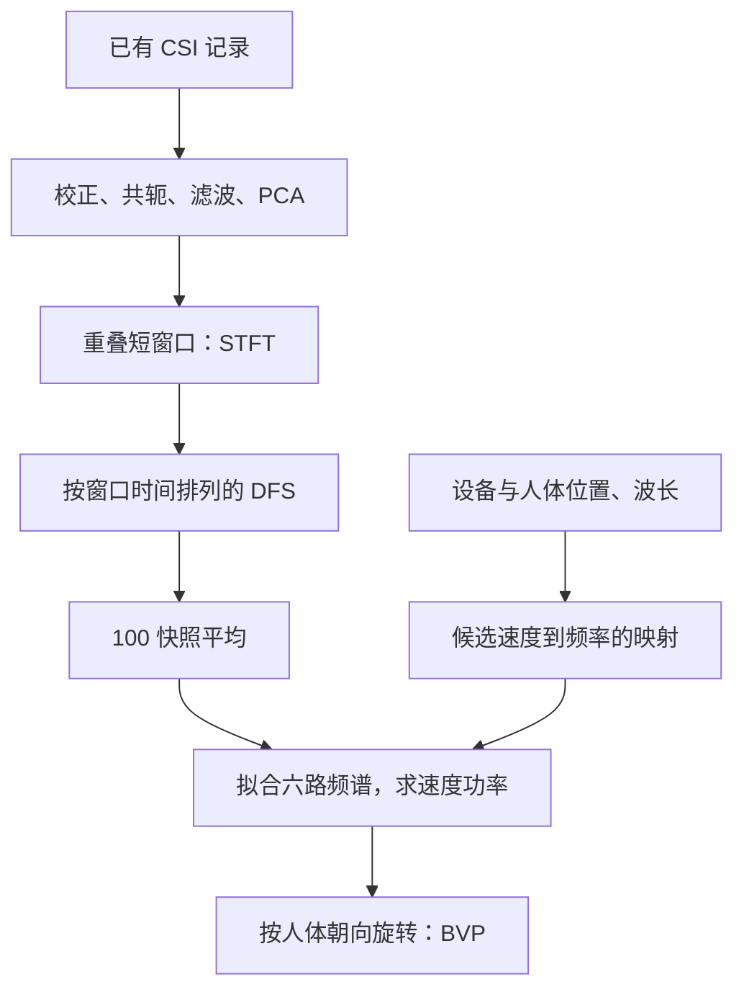

# CSI → DFS → BVP 学习笔记

本笔记对应本次官方单样本复现，保留图解、公式和实际代码位置，并用日常语言解释术语。原问答与容易混淆的地方见 [QUESTIONS.md](QUESTIONS.md)。互动版本见 `learning_notes.html`，下载后用浏览器打开；GitHub页面不直接执行它。

## 先分清三个东西

- **CSI**：无线信号经过传播后，各天线/子载波测到的幅度和相位。采集时已得到，当前从文件读取。
- **DFS**：每个时刻附近有哪些多普勒频率、各有多强。不是人体照片。
- **BVP**：人体坐标系下各种二维速度的信号功率分布。不是人体姿态或位置轨迹。



**时间没有被乱排。** 一段信号计算出一列频谱，列仍按窗口中心的顺序摆好。后续100列平均是另一个操作。

本项目直接使用包内实验位置和朝向，没有另行复现自动定位模块。原代码、新增入口和第三方工具的归属见 `SOURCE.md`。以下行号相对于项目的 `code/` 文件夹；核心作者代码行号保留。

## 1. 选好要处理的文件（启动与文件路径）

来源：**我新增的入口**。输入：`样本名称`；输出：`6 个接收机文件`。

先告诉电脑：这次要看哪一个人的哪一次动作。这个动作被6个接收机从不同位置记录下来，像同一场表演由6台摄像机同时拍摄。电脑按编号依次打开6个文件，再用同一套方法处理。

**术语用日常话解释：**

- **样本**：一次动作的记录。这里一组样本包含6个接收机记录的6份文件。
- **接收机**：接收无线电波并记录测量结果的设备。它不是摄像头，也不会直接拍到人体。
- **天线**：设备收发无线电波的部件。每台接收机有3根接收天线，可以获得不同的信号记录。
- **函数**：一段有名字的办事步骤。调用函数，就像对一个已写好的流程说“请按这套步骤办一次”。
- **路径 / 前缀**：路径是文件在电脑中的地址；前缀是几个文件共同的名称部分。

**数学关系：**

$$
\mathrm{filename}=\mathrm{prefix}+\texttt{-r}+\mathrm{receiver\_id}+\texttt{.dat}
$$

把相同的文件名前半段保留，只替换接收机编号；6表示接收机数，3表示每台的天线数。

**代码名称、位置与实际内容：**

`step1_csi_to_dfs.m` 第 3～5 行：

```matlab
root = setup_reproduction(1);
sample = 'userA-1-1-1-1';
prefix = fullfile(root,'Data',sample);
```

`step1_csi_to_dfs.m` 第 19～19 行：

```matlab
[dfs_fft,freq_fft] = get_doppler_spectrum(prefix,6,3,'stft');
```

`get_doppler_spectrum.m` 第 23～30 行：

```matlab
for ii = 1:rx_cnt
    spth = [spfx_ges, '-r', num2str(ii), '.dat'];
    try
        [csi_data, ~] = csi_get_all(spth);
    catch err
        disp(err)
        continue
    end
```

<details>
<summary>专业原理说明与实现限制</summary>

就像给六个观测位置分别贴编号。入口指定样本，作者函数循环把 r1 到 r6 拼进文件名。同一组处理重复六次，不需要复制六份算法。此处只是启动，还没有生成频谱。

</details>

## 2. 把数据包拆开，摆成表格（解码与整理 CSI）

来源：**官方包附带工具**。输入：`二进制 .dat`；输出：`包数 × 90 个复数`。

作者已经采集并保存了CSI测量记录。这里打开日志文件，取出每个包对应的CSI，校正数值尺度，再摆成表：一包占一行，三根天线各30条子载波排成90列。不是把CSI装进无线数据包，也没有重新采集无线电波。人体运动会使测量值变化，但CSI中也包含静态背景和设备误差。

**术语用日常话解释：**

- **CSI：信道状态信息**：记录无线信号经过传播后变成什么样，像信号走完路留下的体检记录。它包含幅度和相位，不是一张人体照片。
- **幅度**：数值的大小。可以把信号画成一个箭头：箭头长短表示幅度。
- **相位**：一个周期进行到哪里。像钟表指针指到哪个角度；相位不是日期或时刻。
- **复数**：这里是同时保存箭头长度和方向的一种数学写法。“复”不表示重复，也不表示数据更神秘。
- **子载波**：Wi-Fi把传输任务分到多个不同的小频率通道。这组工具每根天线记录30条子载波。
- **矩阵**：一张装数字的表。1479×90就是1479行、90列；每行有3根天线各30个测量值。
- **尺度校正 / RSSI**：校正像把不同刻度的读数换到可比较的尺度；RSSI是设备记录的接收信号强弱信息。

**数学关系：**

$$
H(t)\approx H_{\mathrm{static}}+\sum_\ell\alpha_\ell(t)e^{j\phi_\ell(t)},\quad f_{D,\ell}(t)=\frac{1}{2\pi}\frac{d\phi_\ell(t)}{dt}
$$

H表示无线信道的测量值；它既记录“大小”，也记录“波走到哪一步”。Σ表示把多条传播路线的贡献加起来。相位变化有多快，可以用多普勒频率表示。

**代码名称、位置与实际内容：**

`csi_tool_box/read_bf_file.m` 第 45～53 行：

```matlab
while cur < (len - 3)
    % Read size and code
    field_len = fread(f, 1, 'uint16', 0, 'ieee-be');
    code = fread(f,1);
    cur = cur+3;
    
    % If unhandled code, skip (seek over) the record and continue
    if (code == 187) % get beamforming or phy data
        bytes = fread(f, field_len-1, 'uint8=>uint8');
```

`csi_tool_box/read_bf_file.m` 第 65～67 行：

```matlab
    if (code == 187) %hex2dec('bb')) Beamforming matrix -- output a record
        count = count + 1;
        ret{count} = read_bfee(bytes);
```

`csi_tool_box/get_scaled_csi.m` 第 10～14 行：

```matlab
    csi_sq = csi .* conj(csi);
    csi_pwr = sum(csi_sq(:));
    rssi_pwr = dbinv(get_total_rss(csi_st));
    %   Scale CSI -> Signal power : rssi_pwr / (mean of csi_pwr)
    scale = rssi_pwr / (csi_pwr / 30);
```

`csi_tool_box/get_scaled_csi.m` 第 34～40 行：

```matlab
    quant_error_pwr = scale * (csi_st.Nrx * csi_st.Ntx);

    % Total noise and error power
    total_noise_pwr = thermal_noise_pwr + quant_error_pwr;

    % Ret now has units of sqrt(SNR) just like H in textbooks
    ret = csi * sqrt(scale / total_noise_pwr);
```

`csi_tool_box/csi_get_all.m` 第 1～7 行：

```matlab
function [cfr_array, timestamp] = csi_get_all(filename)
csi_trace = read_bf_file(filename);
timestamp = zeros(length(csi_trace), 1);
cfr_array = zeros(length(csi_trace), 90);

for k = 1:length(csi_trace)
    csi_entry = csi_trace{k}; % for the k_{th} packet
```

`csi_tool_box/csi_get_all.m` 第 10～19 行：

```matlab
        csi_all = squeeze(get_scaled_csi(csi_entry)).'; % estimate channel matrix Hexp-figu
%     catch err
%         disp(err)
%         continue
%     end
    
    csi = [csi_all(:,1); csi_all(:,2); csi_all(:, 3)].'; % select CSI for one antenna pair
    
    timestamp(k) = csi_entry.timestamp_low;
    cfr_array(k,:) = csi;
```

<details>
<summary>专业原理说明与实现限制</summary>

read_bf_file/read_bfee解析已保存的CSI测量记录；get_scaled_csi结合RSSI、自动增益和噪声信息作尺度处理；csi_get_all把每包的三根接收天线、30条子载波排成90列。原始接收机1有1479包，各接收机包数不同。CSI由采集时接收机根据训练信号估计，不由此脚本从原始无线波形重新计算。

</details>

## 3. 看看每个包什么时候到（时间戳与采样假设）

来源：**作者原代码 + 新增时间轴**。输入：`CSI 数字表 + 另一列时间标签`；输出：`按 1000 包/秒建立名义时间`。

读取函数返回两份东西：一张CSI表，和另一列接收时间标签。CSI的第1行对应时间标签第1个值，依次对应。代码没有使用这列标签，而是假设每包相隔1毫秒。因此图上时间按包编号推算，不是电脑执行频谱计算的时刻。

**术语用日常话解释：**

- **时间戳**：记录一个包何时被设备收到的计时数值，不一定是“晚上几点”的日历时间。
- **采样**：把连续变化的情况隔一段时间记录一次，像每隔一会儿拍一张照片。
- **采样率**：每秒记录多少次。1000次/秒意味着名义间隔是0.001秒。
- **名义时间**：按“每包间隔相同”的假设算出来的时间，尚未按真实时间标签校正。
- **~**：MATLAB里的这个符号表示：函数给了我这一项结果，但这次我不接收它。

**数学关系：**

$$
t_{\mathrm{nominal}}[k]=\frac{k-1}{1000}\ \mathrm{s}
$$

第1包当作0秒，第2包当作0.001秒，第3包当作0.002秒。真实间隔要用真实时间标签相减，不能仅靠包编号判断。

**代码名称、位置与实际内容：**

`csi_tool_box/csi_get_all.m` 第 18～19 行：

```matlab
    timestamp(k) = csi_entry.timestamp_low;
    cfr_array(k,:) = csi;
```

`get_doppler_spectrum.m` 第 5～6 行：

```matlab
samp_rate = 1000;
half_rate = samp_rate / 2;
```

`get_doppler_spectrum.m` 第 19～21 行：

```matlab
[csi_data, ~] = csi_get_all([spfx_ges, '-r', num2str(1), '.dat']);
doppler_spectrum = zeros(rx_cnt, 1+freq_lpf_positive_max + freq_lpf_negative_min,...
    floor(size(csi_data, 1)));
```

`step1_csi_to_dfs.m` 第 32～33 行：

```matlab
sample_rate_hz = 1000; % Official code assumes a nominal 1000 packets/s.
time_s = (0:size(doppler_spectrum,3)-1)/sample_rate_hz;
```

<details>
<summary>专业原理说明与实现限制</summary>

时间戳像每个包的接收时刻标签。csi_get_all第18行记录它，但get_doppler_spectrum用~忽略第二个输出，直接假设每秒1000包。若真实包间隔不均匀，名义时间和真实接收时间会不同。下面第二行只演示不均匀的可能情况，不是该样本真实时间戳。

</details>

## 4. 选一根天线当参照（选择参考天线）

来源：**作者原代码**。输入：`Tᵣ × 90`；输出：`参考 CSI：Tᵣ × 90`。

三个观测位置需要一个比较基准。代码在每台接收机的3根天线中，选出读数相对较强、变化相对较小的一根当参照。像量东西时，先选一把比较稳的尺子。然后把这根天线的30条记录复制三遍，方便与其他记录逐个比较。

**术语用日常话解释：**

- **参考天线**：被选来作比较基准的一根天线。每台接收机各选自己的参照。
- **平均值 / mean**：把数字加起来，再除以个数。例如2、4、6的平均值是4。
- **标准差 / std**：表示读数通常离平均值有多远。10、10、10没有波动；8、10、12有波动。
- **方差 / var**：另一种衡量波动的数值；这段代码用sqrt(var(...))得到标准差。
- **reshape**：数字不变，只改变它们在表格里的摆放方式。这里把90个比值摆成30行、3列。
- **repmat**：把同一份数字按指定次数复制、拼接；这里复制的是参考天线数据。

**数学关系：**

$$
q_{a,s}=\frac{\mathrm{mean}_t|H_{a,s}|}{\mathrm{std}_t|H_{a,s}|},\quad a^*=\arg\max_a\mathrm{mean}_s q_{a,s}
$$

先算每列读数的平均大小，再除以这列读数的波动大小；每根天线的30个比值再取平均，选择最大的那根。

**代码名称、位置与实际内容：**

`get_doppler_spectrum.m` 第 36～41 行：

```matlab
    csi_mean = mean(abs(csi_data));
    csi_var = sqrt(var(abs(csi_data)));
    csi_mean_var_ratio = csi_mean./csi_var;
    [~,idx] = max(mean(reshape(csi_mean_var_ratio,[30 rx_acnt]),1));
%     idx = 1;
    csi_data_ref = repmat(csi_data(:,(idx-1)*30+1:idx*30), 1, rx_acnt);
```

<details>
<summary>专业原理说明与实现限制</summary>

像在三把尺子中选一把读数较强、波动较小的当参照。mean 沿时间计算，reshape 将90个比值变成30×3，再比较三根天线。repmat 将被选天线的30条子载波复制三遍，使每条待处理CSI都有对应的参考。不是选择第几个接收机。

</details>

## 5. 减一点底子，调整参照的大小（调整 CSI 幅度）

来源：**作者原代码**。输入：`两组 Tᵣ × 90 复数`；输出：`调整后的两组复数`。

一条记录可以想成“比较固定的底子上，叠着不断变化的部分”。作者从各条记录的大小中减去一个底子，让变化更容易参与后面的处理；又把参考记录整体加大一点。这个操作保留了相位信息。它是一种经验做法，不是把墙壁的影响准确地全部删掉。

**术语用日常话解释：**

- **基线 / α**：这段代码选出来、准备减去的幅度底子；取该列最小的非零幅度。
- **偏置 / β**：给参考幅度整体加上的一个数，像把整排刻度抬高一点。
- **静态分量**：主要来自不动的传播路线，随时间变化较慢。实际环境中也可能有慢变化。
- **动态分量**：主要来自发生运动、导致信号随时间变化的传播路线。
- **abs / angle**：abs取复数箭头的长度；angle取箭头的角度。
- **exp(j·角度)**：一种按指定角度写出方向的数学表达；再乘幅度，就写出了完整复数。

**数学关系：**

$$
\alpha_j=\min_{t:|H_j(t)|\ne0}|H_j(t)|,\quad H_j^{\mathrm{adj}}(t)=\bigl||H_j(t)|-\alpha_j\bigr|e^{j\arg H_j(t)},\quad\beta=1000\mathrm{mean}_j\alpha_j
$$

α是这一列最小的非零幅度；从各时刻幅度减去它。β是根据各列α算出的较大偏置，把参考幅度加上它。角度信息不变。

**代码名称、位置与实际内容：**

`get_doppler_spectrum.m` 第 44～55 行：

```matlab
    csi_data_adj = zeros(size(csi_data));
    csi_data_ref_adj = zeros(size(csi_data_ref));
    alpha_sum = 0;
    for jj = 1:30*rx_acnt
        amp = abs(csi_data(:,jj));
        alpha = min(amp(amp~=0));
        alpha_sum = alpha_sum + alpha;
        csi_data_adj(:,jj) = abs(abs(csi_data(:,jj))-alpha).*exp(1j*angle(csi_data(:,jj)));
    end
    beta = 1000*alpha_sum/(30*rx_acnt);
    for jj = 1:30*rx_acnt
        csi_data_ref_adj(:,jj) = (abs(csi_data_ref(:,jj))+beta).*exp(1j*angle(csi_data_ref(:,jj)));
```

<details>
<summary>专业原理说明与实现限制</summary>

把待处理幅度减去基线，把参考幅度加上偏置，保留两者相位，为后面的共轭处理调整静态背景与动态变化的相对强度。α 是最小非零幅度，β 是作者经验设置；这不等于精确去除了墙壁等全部静态反射。图是教学示意。

</details>

## 6. 比较两路，抵消共同的相位偏差（共轭相乘）

来源：**作者原代码**。输入：`Tᵣ × 90`；输出：`Tᵣ × 60`。

假设两只钟表都一起多转了一点，直接读它们都带有偏差，但比较两只表指针之间的角度时，共同多转的部分可以抵消。作者利用同一接收机不同天线共享的部分相位偏差，用“共轭相乘”做这样的比较。随后删掉参考天线与自己比较的30列，留下60列。

**术语用日常话解释：**

- **共轭 / conj**：对于复数箭头，长度不变，角度变为相反数。可以理解为把它关于水平轴翻转。
- **共轭相乘**：一路记录乘以参考记录的共轭；从角度上看，得到两路角度之差。
- **共同相位偏差**：两路测量同时带上的同一部分角度误差，比如来自接收设备的某些误差。
- **.***：按对应位置相乘：第一格乘第一格、第二格乘第二格。不是普通矩阵乘法。
- **90列 → 60列**：删除参考天线自身的30列，留下另外两根天线各30列。

**数学关系：**

$$
(H_1e^{j\epsilon})\overline{(H_{\mathrm{ref}}e^{j\epsilon})}=H_1\overline{H_{\mathrm{ref}}}
$$

把参考记录的角度反过来，再与另一条记录相乘；乘积的角度相当于两路角度相减。相同的偏差因此相消。

**代码名称、位置与实际内容：**

`get_doppler_spectrum.m` 第 59～60 行：

```matlab
    conj_mult = csi_data_adj .* conj(csi_data_ref_adj);
    conj_mult = [conj_mult(:,1:30*(idx - 1)) conj_mult(:,30*idx+1:90)];
```

<details>
<summary>专业原理说明与实现限制</summary>

像两把尺子同时偏了相同的角度，比较它们时共同偏差相消。同一接收机两根天线共享的相位误差可在共轭相乘中抵消。conj 是复共轭，.* 是对应元素相乘。第60行删除参考天线与自身相乘的30列，剩下两根非参考天线的60列。

</details>

## 7. 筛掉太慢和太快的变化（滤波）

来源：**作者原代码**。输入：`Tᵣ × 60`；输出：`Tᵣ × 60`。

像筛米时把不需要的东西筛出去。这里筛的是信号变化：很慢的变化常含不动背景，过快的变化可能含不需要的抖动。作者用两道筛子，压低很慢和很快的部分，保留这个动作任务关注的变化。筛子有过渡区，不是到了界线就突然完全消失。

**术语用日常话解释：**

- **滤波**：按变化快慢调整信号各部分的强弱，像为记录加上不同的筛选规则。
- **频率 / Hz**：某种周期变化每秒进行多少次；1Hz表示每秒1个周期。这不是说人每秒挥了多少次手。
- **低通**：让较慢的变化较容易保留，压低较快的变化。
- **高通**：让较快的变化较容易保留，压低较慢的变化。
- **奈奎斯特频率**：采样率的一半。这里1000÷2=500Hz；它是设置滤波器时的基准，不是人体运动速度。
- **滤波器阶数**：影响筛选曲线形状和陡峭程度的设置。代码中的6和3是阶数，60和2才是截止频率。

**数学关系：**

$$
Y=\mathrm{HP}_{2\mathrm{Hz}}\bigl(\mathrm{LP}_{60\mathrm{Hz}}(X)\bigr)
$$

先低通，压低60Hz以上的分量；再高通，压低2Hz以下的分量。代码把截止数值除以500，是MATLAB设计这类滤波器所用的输入格式。

**代码名称、位置与实际内容：**

`get_doppler_spectrum.m` 第 5～12 行：

```matlab
samp_rate = 1000;
half_rate = samp_rate / 2;
uppe_orde = 6;
uppe_stop = 60;
lowe_orde = 3;
lowe_stop = 2;
[lu,ld] = butter(uppe_orde,uppe_stop/half_rate,'low');
[hu,hd] = butter(lowe_orde,lowe_stop/half_rate,'high');
```

`get_doppler_spectrum.m` 第 63～66 行：

```matlab
    for jj = 1:size(conj_mult, 2)
        conj_mult(:,jj) = filter(lu, ld, conj_mult(:,jj));
        conj_mult(:,jj) = filter(hu, hd, conj_mult(:,jj));
    end
```

<details>
<summary>专业原理说明与实现限制</summary>

像筛掉不动的背景与太快的抖动，保留任务关注的变化。60 Hz 低通抑制较高频分量；2 Hz 高通抑制静态和缓慢变化。samp_rate=1000是作者假设，500是奈奎斯特频率。它们是本任务的设置，不是所有人体动作的通用参数。

</details>

## 8. 把60条记录合成一条主线（PCA 合成一条序列）

来源：**作者原代码**。输入：`Tᵣ × 60`；输出：`Tᵣ × 1`。

同一动作留下60条记录，很多变化是互相相关的。作者用PCA给各条记录分配组合权重，合成一条变化比较显著的主线。像从许多人一起说的话中找最明显的共同变化。但如果某种噪声变化也很大，它也可能被保留下来。

**术语用日常话解释：**

- **PCA：主成分分析**：一种把多列相关记录组合、压缩的方法。这段代码只保留第一种组合结果。
- **主成分**：根据一组权重算出的综合记录，不是“人体最主要的部位”。
- **权重**：决定每条记录在组合时贡献多少、以什么符号贡献的系数；可以是负数，在这里也可能是复数。
- **最大方差**：组合后的数值变化程度最大；不是“识别准确率最高”的保证。
- **降维**：减少描述数据所用的列数。这里60列变成1列。
- *****：此处为矩阵乘法：按权重把各列组合起来；与逐格相乘的.*不同。

**数学关系：**

$$
z[k]=\sum_{j=1}^{60}X[k,j]w_1[j]
$$

X是60列记录；w₁是一组组合权重。把它们相乘得到一列z。第一主成分指组合后变化程度最大的那个方向。

**代码名称、位置与实际内容：**

`get_doppler_spectrum.m` 第 69～70 行：

```matlab
    pca_coef = pca(conj_mult);
    conj_mult_pca = conj_mult * pca_coef(:,1);
```

<details>
<summary>专业原理说明与实现限制</summary>

像把60位观测者的变化加权合成一条主线。pca 返回组合权重，第一列对应最大方差方向；矩阵乘法将60列合成1列。代码直接对未另行减均值的conj_mult投影。PCA寻找变化最强的方向，不保证其全部来自人体运动。

</details>

## 9. 逐小段看变化的频率（STFT → DFS）

来源：**作者原代码 + 新增保存入口**。输入：`Tᵣ × 1`；输出：`6 × 121 × 1479`。

每次从原记录取251点，像拿一个约0.25秒的小窗口看信号；窗口中心按第1点、第2点、第3点依次移动，窗口大量重叠。每个窗口算出一份频率功率表，并记住它在原记录的中心位置。把这些结果按时间排成列，就是DFS图。时间顺序没有重新打乱。这里显示的是你上传的真实DFS。

**术语用日常话解释：**

- **STFT：短时傅里叶分析**：在一个个短时间窗口中分别检查频率，从而保留“什么时候出现哪种频率”的信息。
- **FFT**：一种快速计算频率成分的方法。像把混合的变化拆成不同快慢的周期成分。
- **窗口 / 高斯窗**：窗口是当前查看的一小段记录；高斯窗让中间部分权重较大、边缘较小，减轻生硬截断的影响。
- **多普勒**：运动改变传播路径，使接收到的相位持续变化所对应的频率。可以借救护车经过时音调变化来理解“运动会影响接收信号”；这里不是测声音。
- **DFS：多普勒频谱**：在各个时刻，多普勒频率分别有多强的一张表或图。
- **功率谱**：表示各个频率成分有多强。这里计算为频率分析结果的大小平方。
- **归一化**：把不同记录换到共同的比较尺度。这里每个时刻所有频率格的功率加起来约为1。
- **分辨率**：区分两个很接近的频率的能力。画了1Hz间隔的格子，不代表能真的分清相差1Hz的两种运动。

**数学关系：**

$$
S[k,m]=\left|\sum_n z[n]w_m[n]e^{-j2\pi kn/1000}\right|^2,\quad D[k,m]=\frac{S[k,m]}{\sum_k S[k,m]}
$$

对每个小窗口分别做FFT，取结果大小平方，然后保留目标频率、按每列总功率归一化。每个窗口的输出就是一份频谱快照，不需要另拍照片；时间标签表示窗口在原记录中的位置。

**代码名称、位置与实际内容：**

`get_doppler_spectrum.m` 第 77～83 行：

```matlab
            time_instance = 1:length(conj_mult_pca);
            window_size = round(samp_rate/4+1);
            if(~mod(window_size,2))
                window_size = window_size + 1;
            end
            freq_time_prof_allfreq = tfrsp(conj_mult_pca, time_instance,...
                samp_rate, tftb_window(window_size, 'gauss'));
```

`tftb/mfiles/tfrsp.m` 第 83～89 行：

```matlab
for icol=1:tcol,
 ti= t(icol); tau=-min([round(N/2)-1,Lh,ti-1]):min([round(N/2)-1,Lh,xrow-ti]);
 indices= rem(N+tau,N)+1; 
 if trace, disprog(icol,tcol,10); end;
 tfr(indices,icol)=x(ti+tau).*conj(h(Lh+1+tau))/norm(h(Lh+1+tau));
end;
tfr=abs(fft(tfr)).^2; 
```

`get_doppler_spectrum.m` 第 88～101 行：

```matlab
    freq_time_prof = freq_time_prof_allfreq(freq_lpf_sele, :);
    % Spectrum Normalization By Sum For Each Snapshot
    freq_time_prof = abs(freq_time_prof) ./ repmat(sum(abs(freq_time_prof),1),...
        size(freq_time_prof,1), 1);
    
    % Frequency Bin(Corresponding to FFT Results)
    freq_bin = [0:freq_lpf_positive_max -1*freq_lpf_negative_min:-1];

    % Store Doppler Velocity Spectrum
    if(size(freq_time_prof,2) >= size(doppler_spectrum,3))
        doppler_spectrum(ii,:,:) = freq_time_prof(:,1:size(doppler_spectrum,3));
    else
        doppler_spectrum(ii,:,:) = [freq_time_prof zeros(size(doppler_spectrum,2),...
            size(doppler_spectrum,3) - size(freq_time_prof,2))];
```

`step1_csi_to_dfs.m` 第 23～24 行：

```matlab
[freq_bin,order] = sort(freq_fft);
doppler_spectrum = dfs_fft(:,order,:);
```

`step1_csi_to_dfs.m` 第 32～35 行：

```matlab
sample_rate_hz = 1000; % Official code assumes a nominal 1000 packets/s.
time_s = (0:size(doppler_spectrum,3)-1)/sample_rate_hz;
save(fullfile(outdir,'DFS.mat'),'doppler_spectrum','freq_bin', ...
    'time_s','sample_rate_hz','sample','dfs_seconds');
```

<details>
<summary>专业原理说明与实现限制</summary>

像用一个短时间窗口沿信号移动，每次听里面有哪些频率。高斯窗251点，FFT为1000点，tfrsp返回功率谱。取−60至60 Hz共121格并逐时刻归一化，再存六路DFS。频率格点1 Hz不代表实际分辨率1 Hz。各路按r1长度截断或补零；没有按时间戳重采样。这里图取自你上传的DFS.mat。 第33行的1:1:实际上保留全部数据包，未降采样。

</details>

## 10. 每100张频谱快照整理成一段（100 快照分段）

来源：**我新增的入口，沿用作者设置**。输入：`6 × 121 × 1479`；输出：`14 组 6 × 121`。

频谱快照只是一个窗口算出的一列频率功率值；在DFS图里已经按时间排好。现在每100列放成一组，把同一频率格的数值平均，再求一次BVP。100是作者选用的参数，能减少波动和求解次数，但会减少时间细节。100个中心相隔约0.1秒，不是100个互不重叠的0.25秒窗口。

**术语用日常话解释：**

- **快照**：这里指一个时刻的频谱记录，不是摄像头拍下的人体照片。
- **分段**：按先后顺序把记录分成较短的时间组。
- **6×121**：一段平均频谱：6个接收机，每个有121个频率格。
- **传播损耗**：信号在传播中会变弱，各条路线整体强弱可能不同。代码用总功率对齐作近似补偿。
- **floor**：向下取整。14.79取14，只保留完整的14段。

**数学关系：**

$$
\overline D_r[k,q]=\frac{1}{100}\sum_{m\in\mathrm{segment}\ q}D_r[k,m],\quad\lfloor1479/100\rfloor=14
$$

每个接收机的每个频率格，在100个快照中取平均；1479÷100只能得到14个完整组。还把不同接收机的总功率调到同一水平。

**代码名称、位置与实际内容：**

`step2_dfs_to_bvp.m` 第 23～29 行：

```matlab
seg_length = 100;
velocity_bin = (-9:10)*0.2; % Official grid: -1.8 to 2.0 m/s.
M = numel(velocity_bin);
lambda = 1e-7;
sparsity_norm = 0;
max_function_evaluations = 100000;
seg_number = floor(size(doppler_spectrum,3)/seg_length);
```

`step2_dfs_to_bvp.m` 第 45～51 行：

```matlab
for ii = 1:seg_number
    target = mean(doppler_spectrum(:,:,(ii-1)*seg_length+1:ii*seg_length),3);
    assert(all(isfinite(target(:))) && all(sum(target,2)>0), ...
        'Segment %d has invalid or missing-link DFS.',ii);
    for r = 2:rx_cnt
        target(r,:) = target(r,:)*sum(target(1,:))/sum(target(r,:));
    end
```

<details>
<summary>专业原理说明与实现限制</summary>

像把连续视频每100个快照整理成一页，估计这一段的速度功率分布。每100个DFS快照求平均，名义上0.1秒；不是另用100点窗重做STFT。末尾79个快照舍弃。再将接收机总功率对齐到r1，以补偿链路整体强弱的影响。 100个内部窗口中心跨度约0.1秒，但由于各窗口长约0.25秒，原信号影响范围约0.35秒。它不是单独从0.1秒原始数据重新做一次FFT。

</details>

## 11. 用设备位置算观察关系（几何与速度映射）

来源：**作者原代码 + 新增调用入口**。输入：`位置 + 400 种候选速度`；输出：`VDM：20 × 20 × 6 × 121`。

设备位置让我们知道观察关系：假设反射点以某个速度运动，每个接收机应看到什么频率。它只给出对应规则，没有给出人实际采用了哪些速度。位置是另外提供的参数，不是CSI直接附带的人体坐标。示意速度箭头只是候选例子。

**术语用日常话解释：**

- **几何关系**：这里就是设备和人体的位置、方向关系。
- **Tx / Rx**：Tx是发射器；Rx是接收器。Rx1就是第1个接收机。
- **波长 / wave_length**：电波一个周期在空间中占的长度。这里约5.15厘米，用它把路径变化与频率联系起来。
- **速度分量 vx、vy**：把一次运动拆成两个互相垂直方向上的速度；单位为米/秒。不是人体位置坐标。
- **投影**：一种运动从某条链路的观察方向看，会表现成什么样。这里把二维速度对应到一个频率。
- **映射 / VDM**：一张预先算好的对应表：哪个候选速度在第几个接收机上落到哪个频率格。
- **round**：取最接近的整数。约8.89Hz在这张对应表中记为9Hz。

**数学关系：**

$$
\mathbf a_r=\frac{\mathbf p-\mathbf{Tx}}{\|\mathbf p-\mathbf{Tx}\|}+\frac{\mathbf p-\mathbf{Rx}_r}{\|\mathbf p-\mathbf{Rx}_r\|},\quad f_r(\mathbf v)=\operatorname{round}\left(\frac{\mathbf a_r\cdot\mathbf v}{\lambda_{\mathrm{wave}}}\right)
$$

人体一动，发射器到人体、人体到接收机的两段路都可能变长或变短，把两段影响合起来，再除以波长。对400种候选二维速度分别算一次。

**代码名称、位置与实际内容：**

`step2_dfs_to_bvp.m` 第 16～24 行：

```matlab
torso_pos = [1.365 0.455];
torso_orientation_deg = -90;
Tx_pos = [0 0];
Rx_pos = [0.455 -0.455; 1.365 -0.455; 2.0 0; ...
          -0.455 0.455; -0.455 1.365; 0 2.0];
rx_cnt = 6;
wave_length = 299792458/5.825e9;
seg_length = 100;
velocity_bin = (-9:10)*0.2; % Official grid: -1.8 to 2.0 m/s.
```

`step2_dfs_to_bvp.m` 第 31～33 行：

```matlab
A = get_A_matrix(torso_pos,Tx_pos,Rx_pos,rx_cnt);
VDM = permute(get_velocity2doppler_mapping_matrix(A,wave_length, ...
    velocity_bin,freq_bin,rx_cnt),[2 3 1 4]);
```

`get_A_matrix.m` 第 5～11 行：

```matlab
    A = zeros(rxcnt,2);
    
    for ii = 1:rxcnt
        dis_torso_tx = sqrt((torso_pos-Tx_pos) * (torso_pos-Tx_pos)');
        dis_torso_rx = sqrt((torso_pos-Rx_pos(ii,:)) * (torso_pos-Rx_pos(ii,:))');
        A(ii,:) = (torso_pos - Tx_pos)/dis_torso_tx + ...
            (torso_pos - Rx_pos(ii,:))/dis_torso_rx;
```

`Doppler2VelocityMapping/get_velocity2doppler_mapping_matrix.m` 第 16～28 行：

```matlab
    VDM = zeros(rx_cnt, M, M, F);
    % For Each Link
    for ii = 1:rx_cnt
        for i = 1:M
            for j = 1:M
                plcr_hz = round(A(ii,:) * [velocity_bin(i) velocity_bin(j)]'...
                    / wave_length);
                if plcr_hz > freq_max || plcr_hz < freq_min
                    VDM(ii,i,j,:) = 1e10*ones(1,size(VDM,4));
                    continue;
                end
                idx = plcr_hz + 1 - freq_min;
                VDM(ii,i,j,idx) = 1;
```

<details>
<summary>专业原理说明与实现限制</summary>

每条无线链路像从不同方向观察运动。人体移动会同时改变Tx→人体和人体→Rx两段距离，因此两个方向向量相加。按作者代码约定，同一个速度在六路上投影到六个频率。示意箭头选v=(0.4,−0.2)m/s，不是当前人体真实速度。几何按人体代表位置近似，正负号不能直接叫靠近/远离。

</details>

## 12. 反过来猜一张速度分布（反推功率分布 P）

来源：**作者原代码**。输入：`候选 P：20 × 20`；输出：`预测 DFS：6 × 121`。

反过来不是反过来拍，也没有再次采集。先猜一张速度功率表，按已知位置关系算出六路预测频谱，与实际DFS比较，再调整猜测。多个速度可能投影到相同频率，因此要同时比较六路并使用少量主要速度的先验。

**术语用日常话解释：**

- **BVP：人体坐标系速度分布**：一张“相对于人体自身朝向，各种速度分别有多少信号功率”的表。不是人体画像或行走路线。
- **P / 候选功率表**：优化器当前猜的一张速度功率表；每个格子是一种(vx,vy)。
- **反推 / 反演**：已知观测结果，利用关系模型估计造成它的运动分布。像看几个方向的影子去推测物体，但结果可能不唯一。
- **EMD：搬土距离**：把一个频率分布搬成另一个，需要搬多远的一种差异指标；相邻峰比相隔很远的峰更容易对齐。代码用累计功率差的绝对值求和来实现。
- **稀疏 / L0**：稀疏是只让少数格子有值；L0在这里数有多少格不为0。作者用它表达“少量主要速度”的偏好。
- **惩罚系数 η / 代码lambda**：决定“少用格子”在目标里占多大权重。这里为1e−7；不是波长。
- **cumsum / triu**：cumsum是从左到右不断累加；这里乘上triu产生的上三角全1表，起到同样的累计作用。

**数学关系：**

$$
\widehat D_r[k]=\sum_{i,j}\mathrm{VDM}[i,j,r,k]P[i,j],\quad\min_{P\ge0}\sum_r\|\operatorname{cumsum}(\widehat D_r-D_r)\|_1+\eta\|P\|_0
$$

把所有落入同一个频率格的候选功率加起来，就是预测频谱。目标是预测和实际尽量接近，同时减少不必要的非零速度格。

**代码名称、位置与实际内容：**

`Doppler2VelocityMapping/DVM_target_func.m` 第 12～17 行：

```matlab
    M = size(P,1);
    F = size(doppler_spectrum_seg_tgt,2);
    P_extent = repmat(P, 1, 1, rx_cnt, F);
    
    % Construct Approximation Doppler Spectrum
    doppler_spectrum_seg_approximate = squeeze(sum(squeeze(sum(P_extent .* VDM, 1)), 1));
```

`Doppler2VelocityMapping/DVM_target_func.m` 第 21～34 行：

```matlab
    floss = 0;
    for ii = 1:rx_cnt
        if(any(doppler_spectrum_seg_tgt(ii,:)))
            floss = floss + sum(abs((doppler_spectrum_seg_approximate(ii,:)...
                - doppler_spectrum_seg_tgt(ii,:)) * triu(ones(F,F),0)));
        end
    end
    % Norm Loss
    if norm == 1
        floss = floss + lambda * sum(sum(P));
    else if norm == 0
            floss = floss + lambda * sum(sum(P~=0));
        end
    end
```

<details>
<summary>专业原理说明与实现限制</summary>

像用6张投影反推一张速度地图。一个格点不是身体位置，而是一种(vx,vy)；格点数值是功率。先将候选P投影成六路频谱，与真实DFS比较；累计差的绝对值构成作者EMD形式，能考虑频率格点间距离。L0项偏好少量非零格点。VDM/几何矩阵A名称不同，别混淆；代码lambda=1e−7是η，不是波长。

</details>

## 13. 让电脑反复试，降低误差（优化求解）

来源：**我新增的入口，沿用作者算法**。输入：`每段 400 个未知功率`；输出：`20 × 20 × 14`。

电脑先把400个速度格子的功率设为0，再不断调整：这一次预测像不像实际频谱？如果目标值下降，就继续寻找。就像反复调配比例，让做出的结果更接近目标。这个过程使用数值求解器，不是在训练一个神经网络；报告停止条件满足，也不等于只有这一个正确答案。

**术语用日常话解释：**

- **优化**：按一个明确的评价规则，不断调整数字，寻找更小的误差。
- **目标函数 / loss**：给当前猜测打分的计算规则。这里分数越小，表示越符合所设目标。
- **fmincon**：MATLAB中的一种带约束数值优化工具，是负责反复调整数字的“试配员”。
- **约束 / 边界**：求解时必须遵守的规则。这里功率不能为负，也不能超过设定上限。
- **收敛 / exit_flag=1**：求解器认为满足了它的停止条件；不是“人体真实速度已百分之百正确”的证明。
- **局部最优 / 全局最优**：局部最优像附近一小片地里较低的位置；全局最优才是整个范围最低的位置。该求解器不保证总能找到全局最优。

**数学关系：**

$$
0\le P[i,j]\le U_{\mathrm{bound}}[i,j]
$$

fmincon在指定边界内调整P，尝试降低“频谱差异+稀疏惩罚”。0≤P是功率不能为负；U_bound是作者实现采用的上限。

**代码名称、位置与实际内容：**

`step2_dfs_to_bvp.m` 第 34～41 行：

```matlab
U_bound = repmat(max(doppler_spectrum(:)),M,M);
velocity_spectrum = zeros(M,M,seg_number);
exit_flags = zeros(seg_number,1);
objectives = zeros(seg_number,1);
segment_seconds = zeros(seg_number,1);
function_counts = zeros(seg_number,1);
options = optimoptions('fmincon','Algorithm','sqp', ...
    'MaxFunctionEvaluations',max_function_evaluations,'Display','off');
```

`step2_dfs_to_bvp.m` 第 53～63 行：

```matlab
    [P,fval,flag,info] = fmincon(@(P)DVM_target_func(P,VDM,lambda, ...
        target,rx_cnt,sparsity_norm),zeros(M,M),[],[],[],[], ...
        zeros(M,M),U_bound,[],options);
    assert(all(isfinite(P(:))),'Invalid solution for segment %d.',ii);
    velocity_spectrum(:,:,ii) = P;
    exit_flags(ii) = flag;
    objectives(ii) = fval;
    segment_seconds(ii) = toc(segment_timer);
    function_counts(ii) = info.funcCount;
    fprintf('Segment %d/%d: exit flag %d, objective %.6g, %.1f s\n', ...
        ii,seg_number,flag,fval,segment_seconds(ii));
```

<details>
<summary>专业原理说明与实现限制</summary>

每段从全零P出发，fmincon反复改变功率，使六路预测DFS更接近观测，并加入稀疏惩罚。这里是物理模型的数值优化，没有训练神经网络。所有段的exit_flag=1表示求解器满足停止条件；原目标含非光滑/不连续项，不能据此保证全局最优或唯一解。此图为你保存的场景坐标系结果，非优化过程动画。

</details>

## 14. 把方向改成以人体自己为准（旋转到人体坐标）

来源：**作者原代码 + 新增调用入口**。输入：`场景坐标速度分布`；输出：`人体坐标 BVP：20 × 20 × 14`。

前面先按房间里的方向描述速度。最后转动这张速度图的方向，让“人面朝的方向”成为横轴的正方向。像你转身后，“向前走”还是相对于你自己的前方，而不是永远朝房间东边。这样同一动作换个朝向后，得到的描述更有机会保持相近。

**术语用日常话解释：**

- **坐标系**：规定从哪里算起、哪些方向叫正方向的一套标尺。
- **人体坐标系**：以人体位置为原点、以人体朝向为正x方向的标尺；这里用来描述运动速度方向。
- **旋转矩阵 R**：计算“换一个方向的标尺后，原来速度该怎样写”的数学工具；图像数组索引另有约定，以实际代码为准。
- **imrotate**：MATLAB中旋转图像数组的函数。这里旋转的是速度分布表。
- **插值 / nearest**：旋转后新格子可能落在原格子之间；nearest使用最近的原格子值。
- **补零 / crop**：补零是在边缘加值为0的格子；crop表示保持指定图片范围，超出的部分裁掉。

**数学关系：**

$$
\mathbf v_{\mathrm{body}}=R(-\theta)\mathbf v_{\mathrm{scene}}\quad\text{（标准向量坐标约定；实际数组旋转以作者函数为准）}
$$

转动速度分布使用已知人体朝向。原网格20×20的零速度不在图片正中心，先补成21×21让零速度位于中心，转动后再裁回原大小。

**代码名称、位置与实际内容：**

`step2_dfs_to_bvp.m` 第 69～74 行：

```matlab
velocity_spectrum_ro = get_rotated_spectrum(velocity_spectrum,torso_orientation_deg);
segment_time_s = ((0:seg_number-1)*seg_length+(seg_length-1)/2)/S.sample_rate_hz;
save(fullfile(outdir,'BVP.mat'),'velocity_spectrum_ro','velocity_spectrum', ...
    'velocity_bin','segment_time_s','torso_pos','torso_orientation_deg', ...
    'Tx_pos','Rx_pos','A','wave_length','seg_length','lambda','sparsity_norm', ...
    'exit_flags','objectives','segment_seconds','function_counts','bvp_seconds','sample');
```

`get_rotated_spectrum.m` 第 13～23 行：

```matlab
    N = size(VS,1);
    T = size(VS,3);
    if mod(N,2) == 0
        % Increment to odd row/column
        % Note: velocity_bin = [-1.8:2], hence 
        VS_1 = [zeros(1,N,T); VS(:,:,:)];
        VS_2 = [zeros(N+1,1,T) VS_1(:,:,:)];
        VS_2_ro = imrotate(VS_2, orientation, 'nearest', 'crop');
        VS_ro = VS_2_ro(2:end,2:end,:);
    else
        VS_ro = imrotate(VS, orientation, 'nearest', 'crop');
```

`step2_dfs_to_bvp.m` 第 78～88 行：

```matlab
% Dimension 1 is vx; dimension 2 is vy. Transpose for imagesc.
selected = unique(round(linspace(1,seg_number,min(6,seg_number))));
fig = figure('Color','w','Position',[100 100 1100 700]);
for k = 1:numel(selected)
    ii = selected(k);
    subplot(2,3,k);
    imagesc(velocity_bin,velocity_bin,velocity_spectrum_ro(:,:,ii).');
    axis xy equal tight; xlabel('Body vx (m/s)'); ylabel('Body vy (m/s)');
    title(sprintf('Segment %d, t = %.2f s',ii,segment_time_s(ii))); colorbar;
end
saveas(fig,fullfile(outdir,'BVP_snapshots.png'));
```

<details>
<summary>专业原理说明与实现限制</summary>

像转动地图的坐标轴，让人体朝向成为正x方向。不能把标准二维向量旋转矩阵的符号直接照搬到图像数组；实际以作者get_rotated_spectrum函数为准。20格网格的零速度不在图像几何中心，因此先补成21×21，让零速度位于中心，旋转再裁回20×20。此图取你上传的BVP.mat第1段。

</details>

## 对照代码时的提醒

- 公式是解释，不是可直接复制运行的MATLAB代码；上面的代码块是实际源文件摘录。
- 无线信号波长是 `wave_length`；稀疏惩罚系数是代码里的 `lambda`，不要混淆。
- `get_A_matrix` 返回几何系数表，`VDM` 才是离散的速度—频率对应表。
- 频谱时间标签指窗口在原信号中的位置；这里按1000包/秒推算，是名义时间。
- “快照”只是频谱的一列；“反推”是数值估计，不是再拍照片。
- CSI折线图只取校正CSI的一列幅度，不是PCA综合序列。
- 实测结果与候选参考对比的范围、证据和未完成事项见项目README及results。

## 资料来源

[官方项目](https://tns.thss.tsinghua.edu.cn/widar3.0/) · [官方论文](https://tns.thss.tsinghua.edu.cn/widar3.0/data/MobiSys19_Widar3.0_paper.pdf)。源码来自官方代码包，保留原文件署名及TFTB许可。
