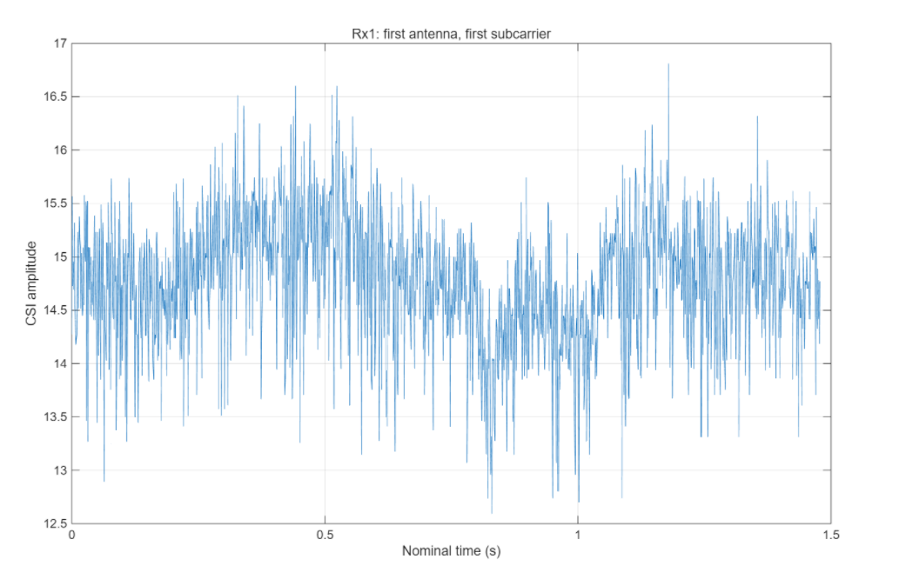
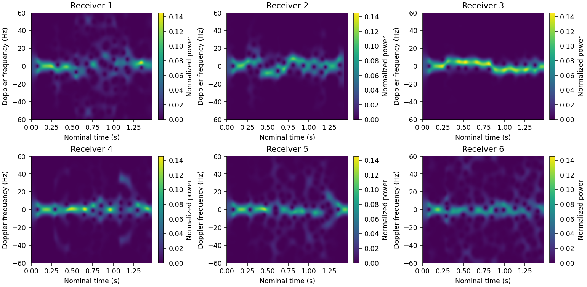
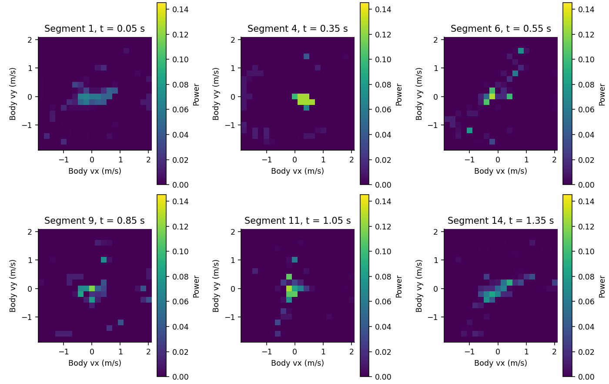
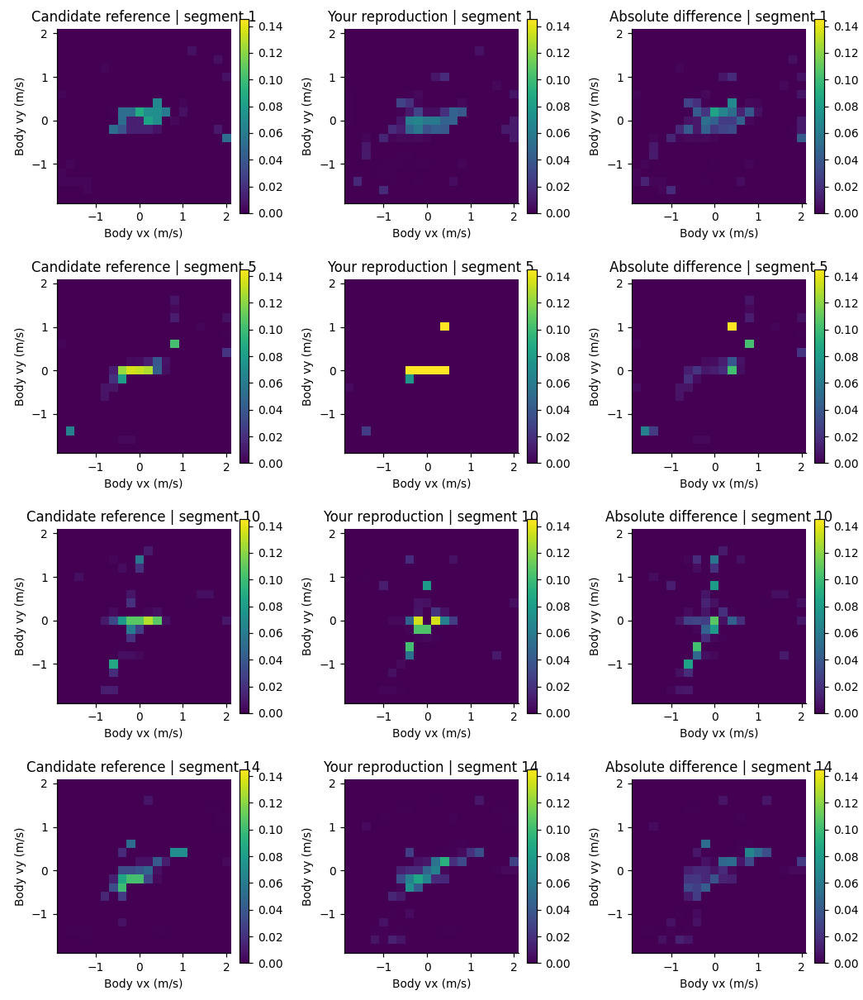
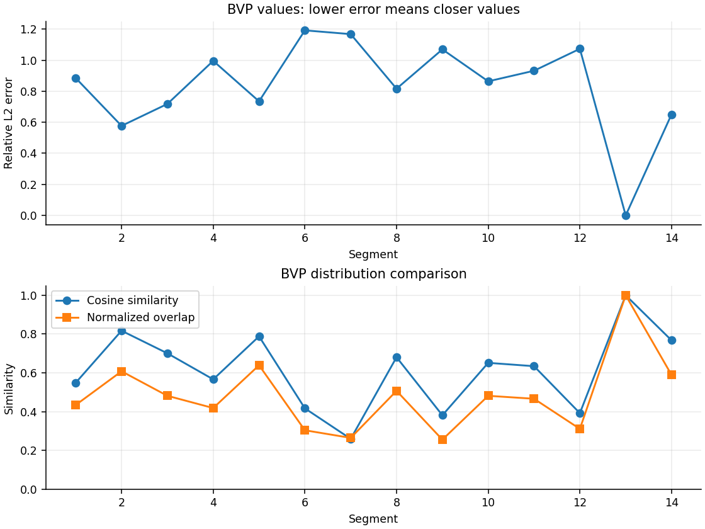
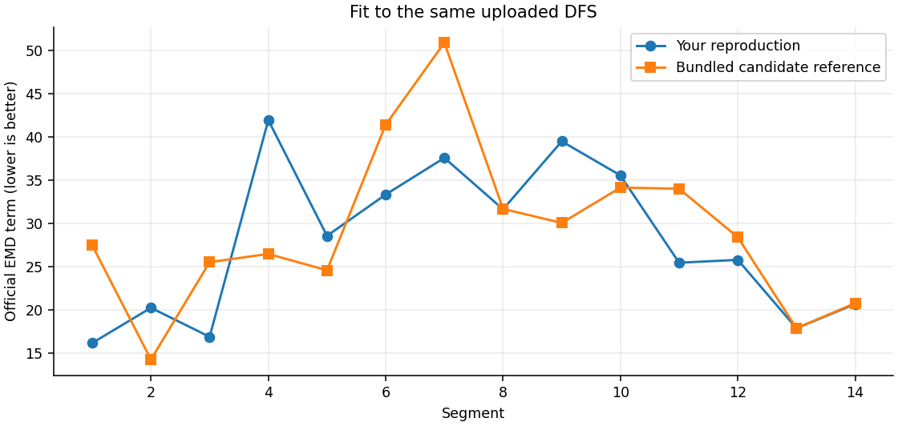

# 单样本实测结果

样本 `userA-1-1-1-1`，使用官方包中的6路CSI；输入已采集完成。Windows MATLAB 分步运行结果包括 `DFS.mat`、`BVP.mat`、优化日志和对比 CSV。

## CSI幅度

接收机1、第一根天线、第一条子载波，直接取尺度校正后的CSI第1列幅度。原图未经过共轭、滤波或 PCA。

## 六路DFS

从上传的 `6×121×1479` 数组重绘；每路是一个接收机，统一色标便于比较。横轴按1000包/秒推算，未使用真实时间戳。STFT窗口251点，中心每次移动1点，窗口重叠。

## 人体坐标BVP

从上传的 `20×20×14` 数组重绘，展示6个时间段；不是6个接收机各自一张BVP。横纵轴是速度，颜色是对应信号功率，不是人体位置。

14段优化退出标志全为1，总求解耗时137.076秒。原退出日志、BVP和指标在 `userA-1-1-1-1/`。每100个DFS快照取平均再求一次BVP，末尾79个快照舍弃；退出标志不证明全局最优或真实速度精确。

## 与包内候选参考比较

参考文件 `user-user-1-1-1-1-1-1e-07-100-20-100000-L0.mat`，形状也是20×20×14，但前缀与输入CSI不同。原包没有明确证明样本对应，不能把它当作已确认真值。

左列候选参考，中列本次结果，右列绝对差；前两列统一色标。

| 指标 | 实际核算 |
|---|---:|
| 平均相对L2差异 | 0.833957 |
| 平均余弦相似度 | 0.614682 |
| 平均归一化重叠度 | 0.482934 |
| 第13段最大绝对差 | 约5.8×10⁻¹² |

以上是两个BVP数组的差异，不是动作分类准确率。

## 对同一实测DFS的拟合核验

按照保存的几何、波长、速度网格与官方映射，将两份BVP投影回六路DFS，计算官方EMD项。原/旋转数组关系已检查，重新计算本次EMD+L0目标值与保存 `objectives` 的最大差约1.42×10⁻¹³。

| 对同一DFS | 本次结果 | 候选参考 |
|---|---:|---:|
| 平均EMD项，越低越好 | 27.938056 | 29.104740 |
| EMD更低的时间段数 | 8 | 5 |

另有1段在1e−7范围内相当。数值仅说明对当前DFS的拟合，不足以确认参考样本身份或真实速度准确性。精确核算见 `DFS_fit_metrics.csv` 和 `verification_summary.json`。

**图像来源：** CSI曲线为用户原图；其他5张由 `code/verify_and_plot.py` 根据用户实际MATLAB输出重绘，未重新运行MATLAB或BVP优化。图片显示采用Python样式，数值来源保留不变。

原始DFS文件约7.8MB未重复提交；本次BVP数组27KB已保存。全部核验输入的SHA256保存在JSON中，原始日志及原对比CSV原样保留。

[返回项目说明](../README.md)
