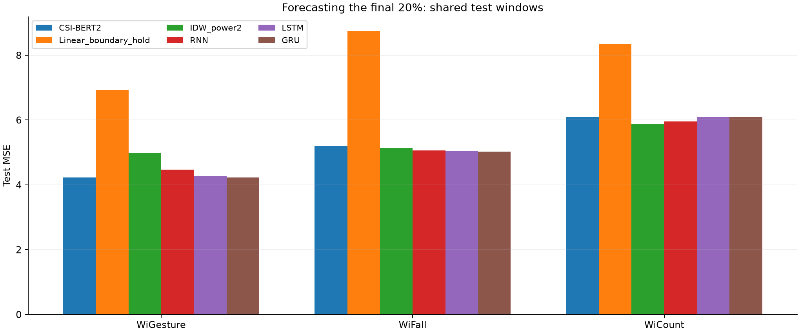
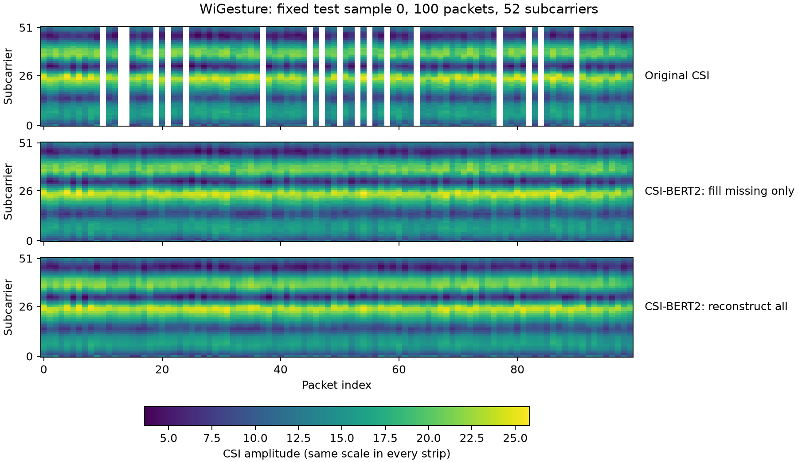

# CSI-BERT2 复现

已完成三个真实数据集核心实验、9 组循环网络基线及选定消融；共 34 个任务模型、1020 个训练轮次记录。**尚未完整复现全部论文指标。**

- [完整结果及与论文的差距](results/REPORT.md)
- [全部指标 CSV](results/runs/comparison.csv)
- [模型实现](code/src/model.py)、[训练入口](code/run.py)、[推理](code/infer.py)

| 数据集 | 恢复 MSE | 末尾20%预测 MSE |
|---|---:|---:|
| WiGesture | 2.4733 | 4.2316 |
| WiFall | 4.8549 | 5.1946 |
| WiCount | 4.2776 | 6.1009 |





## 复现范围和限制

模型包含 ARL、时间嵌入、BERT 主干和任务头，完成 MLM、MPM、分类及 GAN 训练。分类涵盖手势、人员、动作、跌倒、人数估计。基线包括独立配置的 RNN/LSTM/GRU、线性插值和 IDW，并非作者全部基线原实现。

每项30轮、单随机种子42；WiGesture/WiCount按录制时间81/9/10划分，WiFall按人员/动作组内文件划分，验证集选择权重。论文为90/10，裁窗和预算也存在差异。无预训练对照训练全网络，而预训练分类冻结主干，不能将差异只归因于初始化。CommPre原始场景未找到，混合采样率训练、全部基线和多种子统计未完成。

图中 fill missing only 保留观测值，仅补缺失；reconstruct all 全部采用同一模型输出，两者不是两个模型。真实缺失位置无真值，不能从连续热图证明恢复准确；误差测试使用人为遮挡的有效位置。

## 运行与文件

在 code 目录创建 Python 环境，安装对应 CUDA PyTorch 后运行 `pip install -r requirements.txt`。本机验证环境为 Python3.14、PyTorch2.11+cu128、Transformers4.57.6。

数据准备：WiGesture 从 https://huggingface.co/datasets/RS2002/WiGesture 下载 WiGesture.zip，解压动态部分至 code/data/raw/dynamic，再运行 `python prepare_data.py`。其他数据：

```shell
python prepare_extra.py --dataset WiFall --download
python prepare_extra.py --dataset WiCount --download
python train_suite.py --epochs 30
python train_baselines.py --epochs 30
```

训练产生 code/runs 和 code/reports；本仓库 results 是已完成实验的静态快照。大型原始数据、环境和 .pth 权重未放入 Git，仍保存在本机 E:\all\CSI-BERT2-reproduction；已记录权重 SHA256 于 results/runs/completion_audit.json。推理/重新绘图需先把对应 runs 权重与处理数据放入 code 下，或重新训练。已有 PNG、JSON、CSV 无需训练即可查看。

## 来源

基于作者代码 https://github.com/RS2002/CSI-BERT2 ，参考版本见 code/source_revisions.json，保留代码中的作者实现。论文 DOI: 10.1109/TMC.2025.3640420。本文档与图表如实报告本机结果，不声明达到论文全部指标。
